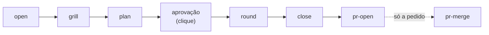

# Mustard — Comandos e Fluxo

Como se usa o Mustard: o caminho de uma obra, os comandos de cada passo, os
comandos do dia, os textos que chegam à janela e os ganchos. Nomes de comando,
opções e chaves ficam como são. O que o Mustard faz por dentro — a instalação, as
regras e as skills que ele gera, os pontos em que consulta o Jev, a publicação e
a busca de código — está em [`docs/mustard-por-dentro.md`](docs/mustard-por-dentro.md).

---

## O caminho

Todo trabalho que muda arquivo passa por um fluxo só. Cada passo é uma chamada ao binário, e a resposta de cada chamada diz qual é o próximo passo: o modelo repassa essa resposta.

O binário executa operações mecânicas: estado, recuperação, contexto, cálculos, validação e geração de páginas. O modelo interpreta, toma decisões que exigem raciocínio e implementa código. Operação mecânica ausente deve virar proposta de comando, não um script improvisado em cada conversa.

| Passo | Comando |
|---|---|
| 1. Abertura | `mustard-rt run open --kind <tipo> --name "<nome>" --base <base>` |
| 2. Levantamento | `mustard-rt run grill --spec <spec>` |
| 3. Plano | `mustard-rt run plan --spec <spec>` |
| 4. Aprovação | nenhum |
| 5. Ondas | `mustard-rt run round --spec <spec>` |
| 6. Fechamento | `mustard-rt run close --spec <spec>` |
| 7. Pull request | `mustard-rt run pr-open --base <base> --head <branch> --spec <spec>` |
| 8. Merge | `mustard-rt run pr-merge --pr <n>` |

Não há comando de entrada: um pedido que muda arquivo, dito na conversa, abre a spec.

---

## Cada passo

### 1. Abertura

`mustard-rt run open --kind <tipo> --name "<nome>" --base <base>`

Cria a branch `<tipo>/<nome>` e a spec com o mesmo nome. O que falta volta como pergunta, com os candidatos. `--pending P-<n>` liga a spec à pendência de onde ela veio.

### 2. Levantamento

`mustard-rt run grill --spec <spec>`

Grava o tipo de trabalho e os pontos da lista, abertos, com os fatos que ela traz. Sem `--kinds`, vale o tipo gravado e, na primeira vez, o do começo da branch; o pedido misto diz os tipos, como `--kinds feature,fix`. `--condensed` junta todos os pontos num bloco só, para um pedido que cabe numa frase.

O assistente inclui os fatos conferidos no próprio `answer --facts '[{"text":"…","source":"…"}]'`, que grava o item e fecha o ponto atomicamente. `write point` com `replaces` e `facts` continua disponível para acrescentar evidências sem responder.

### 3. Plano

`mustard-rt run plan --spec <spec>`

Confere o plano, prepara o pedido canônico e faz a pergunta de aprovação. Não gera nem sincroniza página externa; projeto e specs são acompanhados pelo painel local.

### 4. Aprovação

O clique em "Aprovar" é gravado pela testemunha. "Ajustar" não aprova.

### 5. Ondas

`mustard-rt run round --spec <spec>`

Integra os retornos autorizados, executa build e provas pertinentes, comita e despacha dependentes liberados. Lint e suíte geral ficam para o fechamento.

Perfis de tarefas e julgamentos complementares válidos são reutilizados; dependências, reservas e prioridade são calculadas localmente. Jev só julga candidatos ambíguos.

`--report` recebe consumo/pausas; a entrega é gravada pelo agente com `write delivered`, com envio aberto.

### 6. Fechamento

`mustard-rt run close --spec <spec>`

Executa lint, suíte geral e critérios sobre o código integrado, registra o resultado e reaproveita validação vigente. Mudança de conteúdo, comando ou ambiente invalida o recibo. Falha abre trabalho rastreável de conserto.

A revisão final confere resumos, código, diff e critérios, sem alterar a obra. Só fecha com revisão aprovada e validação válida.

`--report` recebe linhas da rodada; `--pending-later "P-<n>=<motivo>"` registra o destino de cada pendência.

### 7. Pull request

`mustard-rt run pr-open --base <base> --head <branch> --spec <spec>`

Envia a branch ao servidor (o envio recusado para o comando, sem abrir nada), monta o título e o corpo a partir da spec e abre o pull request; o que já existe só tem o corpo reescrito.

Com submódulo mexido pela spec, abre antes o de cada submódulo e o do principal como rascunho, que fica pronto quando eles entram (`pr-merge --root <submódulo>` ou o início da sessão). `--draft` abre como rascunho; `--fill` monta título e corpo pelos commits, para o repositório sem spec.

### 8. Merge

`mustard-rt run pr-merge --pr <n>`

Só quando o usuário pede. Sem veredito aprovado, pergunta e não mexe em nada; `--confirm` é a resposta.

A obra que o git prova na base por merge, juntada fora do fechamento, é entregue na abertura da sessão, sem revisão final. Com cópias no disco, `mustard-rt run deliver-merged --spec <spec>` roda em segundo plano: tira as cópias, guardando o código, e só então grava a entrega.

---

## A entrega da onda

A entrega da onda mora na spec: o agente a grava com `mustard-rt run write delivered`, e só com o envio da onda aberto — sem ele, a gravação é recusada com `no-open-send`, sem gravar nada. A gravação já confere o título do commit (até 60 caracteres: é o teto do título de um commit e de um pull request — o do pull request é o `title` do objetivo ou, sem `title`, a primeira frase dele —, e não o dos 70 do título de um item), o resumo com cara de SHA, o arquivo que o projeto não conhece, a prova nova e a leitura do pedido (recusa `delivery-read-missing`, nomeando o item, se algum item que o pedido da onda lista não foi lido com `run read` de dentro da cópia), e grava a entrega como volta, escondida da leitura até a rodada assumi-la.

A entrega traz `wave`, `text`, `files` e `commit` — o resumo de onde a mensagem do commit é montada, exigido quando há arquivo —, e ainda `proofs` (o critério e o comando de cada teste novo), `fixes` (as ondas que um conserto fecha), `replan` (a mudança, quando o plano da onda não funciona; ela só segue com o clique em "Aceitar"), `undone` (o código de cada tarefa da onda que o agente não fez, obrigatório com `replan` — `[]` quando fez todas —, e só com tarefa da própria onda; com a volta assumida, cada uma volta ao backlog sem a onda, a mudança aceita fica anotada na parte do agente dela, e a resposta da rodada avisa com `tasks-returned`) e `leftovers` (cada sobra com `title` e `detail`, que a rodada grava como tarefa da spec, no backlog; a sobra que só muda comentário, documentação ou texto de ajuda leva `cleanup` (`true`), e a rodada a segura até o fim da obra, junto das outras limpezas numa onda só; o `kind` de uma volta antiga é ignorado).

A rodada assume a volta: grava a entrega oficial, com `replaces` apontando as voltas desde o último envio, e comita com o resumo dela.

O relatório da rodada são as linhas que o orquestrador escreve, uma por linha, quantas forem: `<PAUSED>{…}</PAUSED>` da onda que pausou e `<USAGE>{…}</USAGE>` da onda cujo agente terminou. O resto do texto não é lido; um relatório sem nenhuma dessas marcas é recusado, e a linha `<DELIVERED>` no relatório também, sem gravar nada.

O envio grava os itens que ficaram e, à parte, em `analysis`, o que o Jev tirou e o que pôs, cada um com a chance dele (`Jev p=0.03`).

O veredito é do agente de teste dedicado, que o fechamento pede a toda obra, e ele o grava com `mustard-rt run write verdict`, só com o pedido de revisão aberto e depois de ler, de dentro da cópia, cada item que esse pedido lista (senão recusa `verdict-read-missing`, nomeando o item); a linha `<VERDICT>` no relatório é recusada, como a de entrega. O veredito traz `result` (`approved` ou `rejected`) e `final:true`; a aprovada é a única que vem sem `wave`, e a reprovada traz nele a onda que o conserto refaz. O campo `leftovers`, com os achados que o fechamento grava como tarefas, só vale no veredito final aprovado: no final reprovado a gravação o recusa (`verdict-leftovers-not-approved`), porque nada o leria.

Quando o agente de uma onda termina, o orquestrador escreve a linha `<USAGE>{"wave":1}</USAGE>`, só com a onda: o consumo — o modelo, os passos e os tokens do agente, e os da conversa principal no ramo da spec — a rodada mede nos arquivos de conversa que a plataforma grava, e avisa a onda cujo arquivo não acha. Nenhum número digitado, na linha ou na entrega, vira consumo, e a entrega com o campo de consumo é recusada.

Antes de integrar código, a volta que passa nas conferências espera o aceite do condutor: o aviso `wave-review-required` manda ler o resumo com `mustard-rt run review-wave` e gravar `REVIEWED` com a conclusão, ou `REJECTED` com o motivo. A revisão por agente é uma só, a final da obra. Mudanças invalidam essa revisão; `USAGE` sozinho não aprova.

A linha de consumo identifica a onda que voltou; a de uma onda de lote com envio aberto, sem entrega gravada e com o Claude Code dela fechado marca a onda cortada, e as tarefas dela voltam para o backlog. O fechamento lê o relatório da última rodada pela mesma porta.

---

## Comandos de barra

| Comando | O que faz |
|---|---|
| `/mustard:continue` | Retoma a spec pelo `resume` e repassa o próximo passo. É o botão de reserva: a retomada já acontece no início da sessão. |
| `/mustard:measure` | Roda o `measure` e repassa a frase do veredito: o gasto do Claude no projeto antes e depois da marca da versão. |
| `/mustard:pr` | Abre o pull request, revisa o de um colega ou faz o merge, só a pedido. |
| `/mustard:mods` | Abre o painel nos Mods: visão geral, spec, tarefas e demais itens, uma tarefa, consumo e configurações. Relê a tela visível no fim de cada turno do condutor ou de agente; parado, não consulta. Sem turno de modelo. |
| `/mustard:pages` | `project` publica a visão geral sem exigir spec aberta; `spec` usa a spec da branch atual; `spec <nome>` escolhe outra; `report <arquivo.md>` publica análise/resumo pronto no mesmo layout. Sem destino configurado, entrega arquivos locais. Não inicia turno do modelo. |
| `/mustard:upsert` | Instala ou atualiza o Mustard no projeto, e diagnostica a instalação. |

---

## Os comandos do dia

Quase todos aceitam `--root <pasta>`, que diz de que pasta o repositório é lido; sem ela, vale a pasta atual. Não a aceitam `clean`, `upsert`, `doctor` e `statusline`, que trabalham sempre na pasta atual. Os que trabalham numa spec aceitam `--spec <spec>`; sem ela, vale a spec atual.

Fora os do caminho, estes quatro são os que mais saem: ler a spec, gravar nela, responder um ponto do levantamento e saber onde a obra está.

### `read <bloco>`

Devolve um bloco da spec: `state`, `specification`, `agreed`, `waves`, `wave-<n>`, `criteria`, `review`, `progress`, `notes` ou `conversation`. `--term <termo>` filtra pelo termo ou pelo código do item.

### `write <tipo>`

Grava um evento: `mustard-rt run write point --spec <spec> --json '{…}'`. `lesson` grava no banco de lições. `--copy` é compatibilidade: informa que a publicação automática foi retirada. Links/recibos históricos continuam legíveis. Quando obrigatório, `origin` recebe a última mensagem do usuário se estiver ausente.

Texto longo vai cru, sem escapar em JSON: `--text -` ou `--agent -` lê esse campo da entrada padrão, por heredoc, junto dos outros campos do `--json`; só um dos dois lê a entrada. Vários eventos vão numa chamada só com `--batch`: uma linha JSON por item na entrada padrão, com o tipo em `type` (`{"type":"task", …}`), cada uma conferida e gravada como uma gravação própria, na ordem. Uma linha cita outra do lote pelo `label` dela num campo de referência, como `depends_on`; a linha recusada não grava nada, nem a que a cita. A resposta traz uma linha curta por item: o código gravado, ou o `reason` e o `hint`.

A `task` e o `request` novos passam antes pelo classificador das atividades: com o Jev confiante de que uma tarefa aberta já cobre a atividade ou tem o mesmo sentido, a gravação recusa (`same-work-open`), nomeia a tarefa e manda gravar a versão nova dela (`replaces`); na junção, `rewrite` traz o pedido ao agente de análise da sessão (Haiku no Claude, Luna no Codex), cujo recibo, por `run knowledge --complete-session`, devolve o título, o texto e a parte do agente da versão nova. `"distinct":"<motivo>"` grava assim mesmo e guarda o motivo. Sem Jev, grava como sempre. O `request` novo passa antes pelo lugar dele (veja "O Jev nos pontos de escolha" em [`docs/mustard-por-dentro.md`](docs/mustard-por-dentro.md)).

### `answer`

Grava a resposta de um ponto do levantamento e fecha o ponto numa chamada só: `mustard-rt run answer --point <número ou código> --type <tipo> --json '{…}'`. Sem `--point`, vale o primeiro ponto aberto. Como no `write`, `--text -` ou `--agent -` lê esse campo do item cru da entrada padrão.

`--facts '[{"text":"…","source":"…"}]'` inclui evidências verificadas no fechamento, sem versão manual do ponto. `--result <itens>` aponta itens já gravados, junto do item novo ou sozinhos; `--not-applicable --reason "…"` fecha o ponto sem item. O item passa pelas mesmas recusas do `write`, e o item recusado não fecha o ponto; sem `origin`, ele e o fechamento apontam a última mensagem do usuário. Devolve o item, o fechamento e o próximo ponto.

### `resume`

A fase, o próximo passo em palavras e o comando que o faz.

---

## Quando precisar

Os outros comandos não estão no caminho do trabalho: você os chama quando precisa. Os de uma linha ficam na tabela; os que pedem explicação têm a seção logo abaixo dela.

| Comando | O que faz |
|---|---|
| `index` | Refaz o índice das specs. |
| `scan` | Atualiza o mapa do projeto, lendo só o que mudou; nunca escreve no git. `--full` refaz o mapa de cada subprojeto; `--out <caminho>` grava o modelo em outro lugar. |
| `page` | Gera HTML local no layout do Mustard a partir de markdown: `--body <pagina.md> --out <pagina.html>`, com `--title`, `--subtitle`, `--kind`. Não publica remotamente. |
| `doctor` | Diagnóstico só de leitura. `--check <nome>` roda uma conferência; `--residue` procura também referências mortas; `--format json` ou `--json` responde em JSON. |
| `pr-review` | Sem número, lista os pull requests abertos da base; `--pr <n>` mostra o pedido de revisão. Não grava veredito: `--verdict` recusa na entrada, porque o veredito de cada onda é gravado pela rodada. |
| `discard` | Descarta a spec em duas chamadas: a primeira mostra o que sai e devolve um código; a segunda, com `--confirm <código>`, faz. `--remote` apaga também a branch do servidor; `--delete` apaga a pasta da spec em vez de guardá-la. |
| `panel-diagnostics` | `--record` recebe no stdin os metadados de uma falha do painel ou da medição (componente, operação, motivo e causa curta) e os guarda no diagnóstico local. Nunca envia o diagnóstico nem guarda resultados de ferramentas, conversas ou chaves. |
| `statusline` | Projeção compacta de spec/ondas, comandos do painel, validação e métricas conhecidas; preserva links históricos. Só consulta estado, sem scan, Jev ou publicação. `--preview` mostra os temas. |

### `map <pergunta>`

Pergunta ao mapa do projeto: `examples` (`--file <arquivo>`), `importers --file`, `tests --file`, `slice --file <arquivo> --name <declaração>`, `users --name <declaração>` (quem usa a declaração, como `arquivo:linha:quem chama`; com `--file`, só a desse arquivo) e `summary`.

`search "<padrão>" [<pasta>]` recebe o mesmo texto que o `Grep`, com `-i` (`--ignore-case`), `-w` (`--word-regexp`), `-F` (`--fixed-strings`), `--glob` e `--type`; recuperação local e julgamento complementar de candidatos ambíguos, quando habilitado. Busca literal pelo Grep/rg não chama Jev.

### `knowledge`

Recupera evidência atual por capacidade/fluxo: `mustard-rt run knowledge --query "<assunto>" --limit 8 --depth 2`. `--intent "<tarefa>"` acrescenta pistas nativas; `--purpose` ajusta os trechos atuais e aceita `locate`, `understand`, `spec`, `implement` ou `validate`. Alternativas são candidatas, trechos truncados exigem expansão e ocorrências não indexadas não reutilizam símbolos antigos.

`--file <arquivo>` restringe os pontos de partida; `--detail` expande a evidência. `--symbol <id> --direction callers` investiga consumidores da declaração exata; `outgoing` segue chamadas e `both` os dois sentidos, com fontes conferidas. `--refresh` lista interpretações antigas e fontes afetadas para revisão explícita.

`--all --markdown --out <relatorio.md>` exporta levantamento local; `--record <recibo.json>` registra interpretação com várias fontes/hashes. `--coverage` explica cobertura/exclusões; `--topics <plano.json>` compõe relatório por assuntos; `--evaluate <perguntas.json>` mede arquivos/símbolos e bytes, sem executar spec. Anotações são declarações do autor.

Nativo por padrão; `--responsibility` habilita seleção experimental arquivo→símbolo, que não é padrão por regressão observada. Choice opcional nesse modo exige `ai.fallback:true` e `judgement.search.filter:"jev"`, somente para candidatos ambíguos.

### `triage`

`mustard-rt run triage --spec <spec>` reorganiza a lista aberta numa chamada ao Jev: os grupos de mesmo sentido (a primeira tarefa de cada grupo fica), as tarefas que uma entrega feita já cobre e a ordem dos assuntos por valor (o que destrava mais tarefas ou o usuário, o pedido urgente, o que corta gasto; no empate, o de resultado mais rápido).

Sem `--apply`, não grava nada e responde os grupos, as saídas com o motivo e a ordem. `--apply` grava, sob a trava e tudo ou nada, a versão nova da primeira de cada grupo com o trabalho das outras e remove as outras e as cobertas, com o motivo; a resposta traz, em `rewrite`, o pedido do texto ao agente de análise da sessão. A tarefa presa em onda no ar fica de fora, com aviso; sem Jev, a lista fica como está.

### `reopen`

`mustard-rt run reopen --reason "<motivo>"` reabre a spec para um pedido novo: a que ainda não fechou volta ao levantamento; a fechada ou com o pull request aberto volta à execução, já aprovada, na mesma branch, e o pedido novo entra pelo `write request`; a entregue e a descartada são recusadas.

Com `--fix`, é a porta de conserto do pull request que o servidor reprovou: só com o vermelho relatado, abre a onda de conserto dentro da mesma spec e, com ela entregue e comitada pela rodada, empurra a branch para o servidor — sem reabrir a obra e sem spec nova.

### `pending`

A lista de pendências. Sem opção, mostra as abertas inteiras e só a contagem das fechadas; `--all` traz as fechadas também; `--term <texto>`, sem `--remove`, busca no título e no detalhe de todas e devolve até 30 achados, com "N de M".

`--add --title "…" --detail "…"` acrescenta; `--close P-<n> --reason "…"` dá como entregue; `--remove` com `--id`, `--term` ou `--before <dia>` tira em duas chamadas, a segunda com `--confirm <código>`; `--drop P-<n>` é a mesma saída para um item; `--reopen P-<n>` traz de volta; `--stale` mostra as paradas há 30 dias e `--expire --keep P-<a>,P-<b>` tira as outras.

### `clean`

Lista as cópias descartáveis que os agentes deixaram no diretório temporário. `--dry-run` só lista, que é o padrão; `--apply` apaga as listadas; `--path <pasta ou arquivo>` apaga só aquela pasta ou aquele arquivo do diretório temporário, e recusa link simbólico.

O código que uma cópia tinha além do commit fica guardado em `refs/mustard/kept/<spec>/…`; de spec entregue, a ref cujo código a base já tem, conferido pelo git, sai com `--apply` e na própria entrega, e as outras ficam.

### `panel`

Lê uma tela do painel do `/mustard:mods` em JSON, sem gerar página nem chamar scan, Jev ou modelo: `--root <projeto> --spec <spec> --session <sessão> --section <tela>`.

As telas são `overview` (a spec em três números, avisos, próximo passo — a frase no idioma do projeto e o comando —, ondas no ar, outras specs com aviso e uso do projeto), `spec` (branch, base, combinado, ondas por estado, revisão, PR e lista de specs), `items` (uma página de itens: `--kind <tipo>` (task, criterion, decision, rule ou question), `--query <palavras ou arquivo>`, `--filter <filtro>` (all, attention, committed ou uncommitted), `--offset <n>` e `--limit <n>`, 8 quando ausente; as que pedem atenção vêm primeiro), `item` (`--item <código>`: pedido, o que o agente fez, resultado, término, arquivos, itens cobertos, gasto da onda e histórico de versões), `usage` (histórico medido, 14 dias, custo por spec, esta spec, ferramentas, sessão e disco das cópias) e `waves` (uma página das ondas do plano, a de número maior primeiro: `--offset <n>` e `--limit <n>`, 8 quando ausente e até 50; cada onda com título, estado, tarefas que levou e as que voltaram à cesta, arquivos planejados e entregues, commit, tempo do primeiro envio à entrega aceita, e o modelo, o esforço e os tokens da mesma linha da tela `usage`; o total é o das ondas que a tela `spec` conta).

`--if-revision <revision>` devolve `unchanged:true` quando as fontes da tela não mudaram. `--refresh-consumption` mede uma vez o histórico das conversas e o disco das cópias das ondas; só o botão Medir agora pede essa medida. Sem `--section`, devolve a projeção completa usada pela publicação; `--wave <n>` junta plano, pedido exato, retorno e testes da onda.

Com `--observations`, consulta somente os recibos nativos do envio, em páginas de 32; `--observations-before <next_before>` continua a consulta e `--receipt <recibo>` lê um inteiro. Fonte histórica conserva a data; recibo não comprova a interpretação do agente.

### `settings`

`mustard-rt run settings --root <projeto> --full` devolve a projeção segura usada pela tela Configurações do `/mustard:mods`. `--json '{"schema_version":1,"revision":"<da consulta>","changes":{"vectors":true,"jev_spec_search":false}}'` aplica somente os campos selecionados: `enabled`, `rtk`, `vectors`, `search_answer`, `jev`, `jev_search`, `jev_wave_planning`, `jev_context`, `jev_spec_search`, `agent_model`, `agent_effort`, `review_model`, `review_effort`, `session_claude_model`, `session_codex_model`, `build_command`, `test_command`, `lint_command`, `max_compiling_waves`, `cloudflare_account`, `cloudflare_project` e `cloudflare_token`.

O token do Cloudflare só é gravado e só chega pela entrada padrão, com `--stdin` no lugar do `--json`: no argumento, que outro processo lê, a gravação recusa com `settings-token-argument`. Ele nunca volta na resposta, que diz apenas se há um guardado, e a gravação recusa com `settings-token-exposed` quando o git vê o `mustard.json`.

Conta e projeto seguem a regra da publicação: a conta com 32 dígitos hexadecimais, o projeto em minúsculas, dígitos e hífen no meio, até 58 caracteres. Detecta edição concorrente e preserva os demais campos. Atualiza o gancho RTK e os arquivos dos agentes quando essas opções mudam; não chama IA nem publica.

### `publish`

Gera HTML/JSON/manifesto e publica pelo Cloudflare configurado. Sem seletor, usa a spec da branch atual; `--spec <spec>` escolhe uma, `--project` gera visão geral mesmo sem spec, `--document <arquivo.md>` publica relatório no layout comum. `--include-consumption` autoriza incluir consumo.

Só por pedido explícito; retorna `published:false` enquanto não houver envio remoto confirmado. A configuração do destino está em "Publicação externa nativa", em [`docs/mustard-por-dentro.md`](docs/mustard-por-dentro.md).

### `spend`

Conta localmente conversas por dia/projeto, sem spec aberta. Deduplica mensagens, guarda dias fechados e recalcula hoje. Sem opções, devolve resumo e não prepara página ou lote externo.

`--publish` gera/publica explicitamente um snapshot de todos os dias; `--republish` mantém compatibilidade com o pedido de republicação. `--url <endereço>` registra um endereço confirmado. Cloudflare Pages recebe o snapshot completo pelo binário se configurado; exportação local não confirma publicação.

### `usage-record`

`mustard-rt run usage-record --root <projeto> --session <sessão>` recebe medição do host no stdin, inclusive contexto e cotas sem custo em dólares.

`kind:step` registra usage por `turn_id`/`index` e `agent_id`; repetições não somam novamente. `kind:spawn` e `kind:complete` registram o ciclo do agente. A visão ao vivo não é somada ao histórico de transcrições. Totais cumulativos não são somados repetidamente; a atribuição por spec usa intervalos observados na mesma branch. Custo é estimativa equivalente de API, com cobertura explícita; não é valor cobrado pela assinatura.

### `upsert`

Instala ou atualiza. Na mesma chamada, tira as sobras do Mustard antigo nos `CLAUDE.md` e no `settings.json` da equipe, com as regras das Guards indo antes para um item só da lista de pendências, troca no lugar as regras de bloqueio da equipe escritas errado, e diz o que saiu e o que mudou; o arquivo sem marca só aparece na lista.

Enquanto o `mustard.json` não tem `localFiles`, responde `localFilesFound`, os arquivos que o git ignora fora das pastas ignoradas; `--local-files <a,b>` grava a lista confirmada e `--prepare <comando>` o comando que prepara cada cópia, e o valor vazio grava que não há.

### `measure`

O gasto do Claude no projeto antes e depois da marca da versão: a primeira sessão de cada compilação do Mustard no projeto, que o início da sessão grava. Compara os dias contados (fechados, com 100 ações ou mais; o dia da marca fica fora) dos dois lados, pela mesma conta do `spend`, e só afirma com 5 de cada lado.

Responde `project`, `mark`, `before`, `after`, `verdict` e o veredito numa frase em `text`; sem marca, diz que a medição começa na próxima sessão. `--since <instante>` (RFC 3339 ou `AAAA-MM-DD`) mede a partir dele. Só lê: não grava nada e não chama o Jev.

---

## O que chega à janela

- **O mapa do início da sessão** (`.claude/mustard/session-map.md`, até 3 kB): o fluxo, quando uma spec abre e onde cada coisa mora. Entra uma vez por conteúdo na sessão. Após `/clear` e compactação, o guia gerenciado volta em uma versão curta com a retomada; instruções pessoais são preservadas.
- **A linha de cada mensagem** (até 100 caracteres): o idioma do texto e "texto simples". Depois de uma resposta com erro de escrita, ela leva mais uma frase curta com o erro, como "Na última resposta: frase com 29 palavras.", uma vez só.
- **O estilo de resposta** do plugin, um por idioma (`mustard:mustard-pt-BR`, `mustard:mustard-en-US`), escolhido pelo instalador na chave `outputStyle` do `.claude/settings.local.json`.
- **Os três agentes**, em `.claude/agents/mustard/`, no idioma do texto: `analysis` enriquece evidências delimitadas, `wave` implementa uma onda, e `review` confere a obra integrada no final, um levantamento ou o pull request de um colega. Resumos orientam a investigação; as conclusões são conferidas no código.

O modelo de cada onda sai da dificuldade das tarefas dela: na formação das ondas, o Jev dá a cada tarefa uma nota de complexidade de quatro níveis, gravada em `group.difficulty`; os níveis 0, 1 e 2 vão ao `sonnet` e o 3 ao `opus` — a implementação nunca vai ao `haiku` —, e a nota com confiança abaixo de 0,5 sobe um degrau. A onda leva o maior modelo das tarefas dela, e a tarefa sem nota — sem Jev, ou sem resposta dele nem da reserva — vai ao `sonnet`.

A onda reprovada (pela linha `REJECTED`, pelo veredito ou pela volta recusada que vai a um agente novo) volta um degrau acima — `haiku`, `sonnet`, `opus`; o `opus` fica —, e o envio grava de onde subiu em `escalated_from`. `agents.by_difficulty: false` desliga a regra: toda onda vai no modelo de `agents.model`, sem subida; só aí o `agents.model` vale para a onda. O revisor final usa o modelo que a chamada pede e, sem pedido, o de `agents.review` ou o `opus`, sem herdar o `agents.model`; o envio do pedido da revisão grava o que valeu em `model_used`. A onda segue o modelo da rodada.

O esforço é sempre `xhigh`, em todo agente e modelo, imposto no lançamento sobre o que a chamada pedir; `agents.effort` e `agents.review.effort` só vão ao cabeçalho do agente instalado. O envio da onda grava o modelo e o esforço pedidos, o modelo usado (`model_used`, medido na conversa do agente) e o esforço que valeu no lançamento (`effort_used`: o de `CLAUDE_CODE_EFFORT_LEVEL` quando a variável está definida, ou o imposto). Sem `agents.model` nem `agents.effort`, a instalação os grava com `sonnet` e `xhigh`. O `analysis` roda no modelo pequeno da sessão, sempre no esforço `xhigh`, que o lançamento impõe sobre o que a chamada pedir.

Quem conduz recebe um aviso curto aos 200 mil tokens e em cada faixa seguinte de 100 mil, uma vez por faixa. Limpar ou compactar a sessão reinicia essa contagem. Para o agente, o sinal chega aos 200 mil tokens de contexto, contando a entrada e os resumos herdados, ou antes, aos 75% da janela do modelo que o atende, quando ela é menor. O próprio passo de término da tarefa responde se o agente segue ou entrega. Com agente vivo, o aviso de quem conduz manda esperar a volta dele antes de `/clear`, e a retomada depois de limpar lista as ondas cujo agente parou. Ao sinal, ele conclui a tarefa atual, os testes mínimos e o resumo, sem iniciar outra tarefa após a ordem de entrega.

---

## Os ganchos

| Gancho | Quando | O que faz |
|---|---|---|
| `session_start_inject` | início da sessão | Coloca mapa, retomada e avisos até 3 kB, incluindo o comando do painel local. Não prepara páginas nem pede sincronização/publicação externa, inclusive de gasto. |
| `statusline_heal_observer` | início da sessão | Conserta a barra de status. |
| `prompt_entry` | cada mensagem | Grava a mensagem na spec atual; depois de uma resposta com erro de escrita, coloca a linha curta com o erro, uma vez. |
| `write_gate` | antes de arquivos e depois de buscas | Conserva as proteções de escrita, segredo e leitura. Grep/rg executam com seus argumentos originais; compactação posterior só usa resultados executados verificáveis, sem Jev de rotina e sem transformar resultado em instrução. |
| `command_guard` | antes de um comando | Recusa comando que apaga trabalho. |
| `subagent_inject` | antes de despachar um agente | Troca o texto do despacho que abre com o título de uma onda em andamento pelo título e pelo comando que lê o pedido gravado dela. |
| `approval_witness` | depois de uma pergunta com opções | Grava o clique em "Aprovar" ou "Aceitar". |
| `end_of_turn_check` | fim da resposta | Confere a escrita: o erro achado vai na linha da mensagem seguinte, sem barrar. Barra quando a resposta sai noutro idioma que não o do projeto, para o assistente escrevê-la de novo, e quando a spec fecha ou entra no merge e a resposta não cita uma pendência aberta nascida nela. |
| `session_cleanup_observer` | fim da sessão | Solta a spec da sessão. |

O painel conta as chamadas observadas do fluxo, leitura, gravação e busca, inclusive recusas. A medição de transporte de `read`, `write` e `search` fica em `.claude/mustard/operations/<spec>.ndjson`, separada dos itens e dos recibos obrigatórios de leitura do agente. Uma gravação recusada não muda o histórico canônico da spec. Bytes são medidos; tokens de transporte são aproximações pelo tamanho do texto, sem guardar o conteúdo dos argumentos. Essas contagens não demonstram, sozinhas, economia de tokens ou de dinheiro.

O painel lê o binário ao abrir, ao trocar de tela e no fim de cada turno: o `turn.complete` do condutor e o `classic.SubagentStop` de um agente releem só a tela visível, com `--if-revision`. Parado, não consulta nada; ferramentas e passos não disparam leitura. `session.measure` fornece contexto, custo informado e limites diretamente do host. Observar um evento não acrescenta um novo recibo de entrega/validação: o histórico canônico permanece no binário. Hooks clássicos continuam aplicando as validações nativas.

`/mustard:mods` e `/mustard:pages` são os arquivos `mods.md` e `pages.md` do plugin, e por isso levam o prefixo `mustard:`. O módulo dos Mods responde aos dois antes de o arquivo virar texto para o modelo: a publicação mecânica não consome turno. Se o módulo falha, ele mesmo responde com um aviso, e nada roda. Os dois arquivos ficam fora do alcance do modelo (`disable-model-invocation`). Digitados no meio de uma resposta, esperam o fim dela. Relatórios atuais publicam texto/tabelas do Markdown; anexos em arquivos locais não são enviados implicitamente. A leitura do arquivo é explícita e não inclui outras conversas, código ou a spec inteira por conta própria.

---

## Evidências e aprovação do objetivo

`mustard-rt run evidence [--root <projeto>] [--spec <spec>] [--wave <n>]` lista até 32 recibos nativos. Sem onda, lista as observações do condutor, inclusive durante o levantamento. `--point <código-ou-id> --receipt <recibo> --text "<medida, entrada e limites>"` anexa ao ponto, preservando seu código e situação; repetir a mesma associação não grava outra versão. O recibo prova qual resultado a ferramenta devolveu, não a interpretação do modelo. Comentários e relações estáticas continuam candidatos para investigação.

`resume` e `grill` devolvem `goal_approval`: objetivo direto do usuário já é confirmado; sugestão usa a pergunta e opções devolvidas, com cabeçalho `MustardGoal`, ou uma pergunta curta com o mesmo cabeçalho e as duas opções, quando a fala logo antes dela mostra o objetivo inteiro; o `hint` de `goal_approval` diz como. O hook grava a confirmação no mesmo clique; retomar não depende da memória da conversa. O `grill` entrega o próximo ponto completo, um índice dos demais e até três referências com coordenadas exatas. Os comandos `expand` recuperam o material completo.
