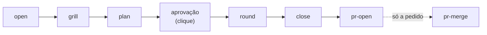

# Mustard — Comandos e Fluxo

Referência de tudo o que o Mustard publica: o fluxo, os comandos de barra, os textos que chegam à janela, os ganchos e os comandos `mustard-rt run`. Nomes de comando, opções e chaves ficam como são.

---

## O fluxo

Todo trabalho que muda arquivo passa por um fluxo só. Cada passo é uma chamada ao binário, e a resposta de cada chamada diz qual é o próximo passo: o modelo repassa essa resposta. O binário executa operações mecânicas: estado, recuperação, contexto, cálculos, validação e geração de páginas. O modelo interpreta, toma decisões que exigem raciocínio e implementa código. Operação mecânica ausente deve virar proposta de comando, não um script improvisado em cada conversa.



| Passo | Comando | O que faz |
|---|---|---|
| 1. Abertura | `mustard-rt run open --kind <tipo> --name "<nome>" --base <base>` | Cria a branch `<tipo>/<nome>` e a spec com o mesmo nome. O que falta volta como pergunta, com os candidatos. `--pending P-<n>` liga a spec à pendência de onde ela veio. |
| 2. Levantamento | `mustard-rt run grill --spec <spec>` | Grava o tipo de trabalho e os pontos da lista, abertos, com os fatos que ela traz. Sem `--kinds`, vale o tipo gravado e, na primeira vez, o do começo da branch; o pedido misto diz os tipos, como `--kinds feature,fix`. `--condensed` junta todos os pontos num bloco só, para um pedido que cabe numa frase. O assistente inclui os fatos conferidos no próprio `answer --facts '[{"text":"…","source":"…"}]'`, que grava o item e fecha o ponto atomicamente. `write point` com `replaces` e `facts` continua disponível para acrescentar evidências sem responder. |
| 3. Plano | `mustard-rt run plan --spec <spec>` | Confere o plano, prepara o pedido canônico e faz a pergunta de aprovação. Não gera nem sincroniza página externa; projeto e specs são acompanhados pelo painel local. |
| 4. Aprovação | nenhum | O clique em "Aprovar" é gravado pela testemunha. "Ajustar" não aprova. |
| 5. Ondas | `mustard-rt run round --spec <spec>` | Integra os retornos autorizados, executa build e provas pertinentes, comita e despacha dependentes liberados. Lint e suíte geral ficam para o fechamento. Perfis de tarefas e julgamentos complementares válidos são reutilizados; dependências, reservas e prioridade são calculadas localmente. Jev só julga candidatos ambíguos. `--report` recebe consumo/pausas; a entrega é gravada pelo agente com `write delivered`, com envio aberto. |
| 6. Fechamento | `mustard-rt run close --spec <spec>` | Executa lint, suíte geral e critérios sobre o código integrado, registra o resultado e reaproveita validação vigente. Mudança de conteúdo, comando ou ambiente invalida o recibo. Falha abre trabalho rastreável de conserto. A revisão final confere resumos, código, diff e critérios, sem alterar a obra. Só fecha com revisão aprovada e validação válida. `--report` recebe linhas da rodada; `--pending-later "P-<n>=<motivo>"` registra o destino de cada pendência. |
| 7. Pull request | `mustard-rt run pr-open --base <base> --head <branch> --spec <spec>` | Envia a branch ao servidor (o envio recusado para o comando, sem abrir nada), monta o título e o corpo a partir da spec e abre o pull request; o que já existe só tem o corpo reescrito. Com submódulo mexido pela spec, abre antes o de cada submódulo e o do principal como rascunho, que fica pronto quando eles entram (`pr-merge --root <submódulo>` ou o início da sessão). `--draft` abre como rascunho; `--fill` monta título e corpo pelos commits, para o repositório sem spec. |
| 8. Merge | `mustard-rt run pr-merge --pr <n>` | Só quando o usuário pede. Sem veredito aprovado, pergunta e não mexe em nada; `--confirm` é a resposta. A obra que o git prova na base por merge, juntada fora do fechamento, é entregue na abertura da sessão, sem revisão final. Com cópias no disco, `mustard-rt run deliver-merged --spec <spec>` roda em segundo plano: tira as cópias, guardando o código, e só então grava a entrega. |

A entrega da onda mora na spec: o agente a grava com `mustard-rt run write delivered`, e só com o envio da onda aberto — sem ele, a gravação é recusada com `no-open-send`, sem gravar nada. A gravação já confere o título do commit (até 60 caracteres), o resumo com cara de SHA, o arquivo que o projeto não conhece, a prova nova e a leitura do pedido (recusa `delivery-read-missing`, nomeando o item, se algum item que o pedido da onda lista não foi lido com `run read` de dentro da cópia), e grava a entrega como volta, escondida da leitura até a rodada assumi-la. A entrega traz `wave`, `text`, `files` e `commit` — o resumo de onde a mensagem do commit é montada, exigido quando há arquivo —, e ainda `proofs` (o critério e o comando de cada teste novo), `fixes` (as ondas que um conserto fecha), `replan` (a mudança, quando o plano da onda não funciona; ela só segue com o clique em "Aceitar"), `undone` (o código de cada tarefa da onda que o agente não fez, obrigatório com `replan` — `[]` quando fez todas —, e só com tarefa da própria onda; com a volta assumida, cada uma volta ao backlog sem a onda, a mudança aceita fica anotada na parte do agente dela, e a resposta da rodada avisa com `tasks-returned`) e `leftovers` (cada sobra com `title` e `detail`, que a rodada grava como tarefa da spec, no backlog; a sobra que só muda comentário, documentação ou texto de ajuda leva `cleanup` (`true`), e a rodada a segura até o fim da obra, junto das outras limpezas numa onda só; o `kind` de uma volta antiga é ignorado). A rodada assume a volta: grava a entrega oficial, com `replaces` apontando as voltas desde o último envio, e comita com o resumo dela. O relatório da rodada são as linhas que o orquestrador escreve, uma por linha, quantas forem: `<PAUSED>{…}</PAUSED>` da onda que pausou e `<USAGE>{…}</USAGE>` da onda cujo agente terminou. O resto do texto não é lido; um relatório sem nenhuma dessas marcas é recusado, e a linha `<DELIVERED>` no relatório também, sem gravar nada. O envio grava os itens que ficaram e, à parte, em `analysis`, o que o Jev tirou e o que pôs, cada um com a chance dele (`Jev p=0.03`). O veredito é do agente de teste dedicado, que o fechamento pede a toda obra, e ele o grava com `mustard-rt run write verdict`, só com o pedido de revisão aberto e depois de ler, de dentro da cópia, cada item que esse pedido lista (senão recusa `verdict-read-missing`, nomeando o item); a linha `<VERDICT>` no relatório é recusada, como a de entrega. O veredito traz `result` (`approved` ou `rejected`) e `final:true`; a aprovada é a única que vem sem `wave`, e a reprovada traz nele a onda que o conserto refaz. Quando o agente de uma onda termina, o orquestrador escreve a linha `<USAGE>{"wave":1}</USAGE>`, só com a onda: o consumo — o modelo, os passos e os tokens do agente, e os da conversa principal no ramo da spec — a rodada mede nos arquivos de conversa que a plataforma grava, e avisa a onda cujo arquivo não acha. Nenhum número digitado, na linha ou na entrega, vira consumo, e a entrega com o campo de consumo é recusada. Antes de integrar código, a volta que passa nas conferências vai ao revisor de onda, de contexto limpo: a rodada grava o pedido dele (envio de papel `wave-review`, com a onda em `reviews` e a impressão do diff em `fingerprint`), lido por `mustard-rt run read review-request-<n>` — o diff da onda contra a base, cortado por arquivo no teto do pedido com a lista do que ficou de fora, as tarefas, o texto inteiro do que elas cobrem, as regras e decisões da onda, as regras do projeto pelos arquivos tocados, as skills e as provas —, e o aviso `wave-review-required` diz como lançar o `mustard-review` (`review.title` e `review.read`). O revisor grava um veredito curto com `run write verdict` (`wave`, `result`, `text` e, na reprovação, `files`); a gravação o marca com `wave_review`, e ele nunca fecha a revisão final, nem ela o dele. Na rodada seguinte, o aprovado vale como o aceite e a onda vai ao commit; o reprovado devolve a onda a um agente novo com o motivo e os arquivos, pela mesma reprovação de `REJECTED`, conta no limite de consertos e sobe o modelo. O condutor lê só o veredito, em `recorded`. Com `agents.wave_review.enabled: false`, ou quando decidir, o condutor lê `review-wave` e grava `REVIEWED` com a conclusão. Mudanças invalidam essa revisão; `USAGE` sozinho não aprova. A linha de consumo identifica a onda que voltou; a de uma onda de lote com envio aberto, sem entrega gravada e com o Claude Code dela fechado marca a onda cortada, e as tarefas dela voltam para o backlog. O fechamento lê o relatório da última rodada pela mesma porta.

---

## Comandos de barra

| Comando | O que faz |
|---|---|
| `/mustard:continue` | Retoma a spec pelo `resume` e repassa o próximo passo. É o botão de reserva: a retomada já acontece no início da sessão. |
| `/mustard:measure` | Roda o `measure` e repassa a frase do veredito: o gasto do Claude no projeto antes e depois da marca da versão. |
| `/mustard:pr` | Abre o pull request, revisa o de um colega ou faz o merge, só a pedido. |
| `/mustard:mods` | Abre o painel nos Mods: visão geral, spec, tarefas e demais itens, uma tarefa, consumo e configurações. Relê a tela visível no fim de cada turno do condutor ou de agente; parado, não consulta. Sem turno de modelo. |
| `/mustard:pages` | `project` publica a visão geral sem exigir spec aberta; `spec` usa a spec da branch atual; `spec <nome>` escolhe outra; `report <arquivo.md>` publica análise/resumo pronto no mesmo layout. Sem destino configurado, entrega arquivos locais. Não inicia turno do modelo. |
| `/mustard:upsert` | Instala ou atualiza o Mustard no projeto, e diagnostica a instalação. |

Não há comando de entrada: um pedido que muda arquivo, dito na conversa, abre a spec.

---

## O que chega à janela

- **O mapa do início da sessão** (`.claude/mustard/session-map.md`, até 3 kB): o fluxo, quando uma spec abre e onde cada coisa mora. Entra uma vez por conteúdo na sessão. Após `/clear` e compactação, o guia gerenciado volta em uma versão curta com a retomada; instruções pessoais são preservadas.
- **A linha de cada mensagem** (até 100 caracteres): o idioma do texto e "texto simples". Depois de uma resposta com erro de escrita, ela leva mais uma frase curta com o erro, como "Na última resposta: frase com 29 palavras.", uma vez só.
- **O estilo de resposta** do plugin, um por idioma (`mustard:mustard-pt-BR`, `mustard:mustard-en-US`), escolhido pelo instalador na chave `outputStyle` do `.claude/settings.local.json`.
- **Os três agentes**, em `.claude/agents/mustard/`, no idioma do texto: `analysis` enriquece evidências delimitadas, `wave` implementa uma onda, e `review` confere a obra integrada no final, um levantamento ou o pull request de um colega. Resumos orientam a investigação; as conclusões são conferidas no código. O modelo de cada onda sai da dificuldade das tarefas dela: na formação das ondas, o Jev dá a cada tarefa uma nota de complexidade de quatro níveis, gravada em `group.difficulty`; os níveis 0, 1 e 2 vão ao `sonnet` e o 3 ao `opus` — a implementação nunca vai ao `haiku` —, e a nota com confiança abaixo de 0,5 sobe um degrau. A onda leva o maior modelo das tarefas dela, e a tarefa sem nota — sem Jev, ou sem resposta dele nem da reserva — vai no modelo de `agents.model`. A onda reprovada (pela linha `REJECTED`, pelo veredito ou pela volta recusada que vai a um agente novo) volta um degrau acima — `haiku`, `sonnet`, `opus`; o `opus` fica —, e o envio grava de onde subiu em `escalated_from`. `agents.by_difficulty: false` desliga a regra: toda onda vai no modelo de `agents.model`, sem subida. O revisor final usa o modelo de `agents.review`; o revisor de cada onda, o de `agents.wave_review.model`, `sonnet` por padrão. O esforço é sempre `xhigh`, em todo agente e modelo, imposto no lançamento sobre o que a chamada pedir; `agents.effort` e `agents.review.effort` só vão ao cabeçalho do agente instalado. O envio da onda grava o modelo e o esforço pedidos, o modelo usado (`model_used`, medido na conversa do agente) e o esforço que valeu no lançamento (`effort_used`: o de `CLAUDE_CODE_EFFORT_LEVEL` quando a variável está definida, ou o imposto). Sem `agents.model` nem `agents.effort`, a instalação os grava com `sonnet` e `xhigh`. O `analysis` roda no modelo pequeno da sessão, sempre no esforço `xhigh`, que o lançamento impõe sobre o que a chamada pedir.

---

## Os ganchos

| Gancho | Quando | O que faz |
|---|---|---|
| `session_start_inject` | início da sessão | Coloca mapa, retomada e avisos até 3 kB, incluindo o comando do painel local. Não prepara páginas nem pede sincronização/publicação externa, inclusive de gasto. |
| `statusline_heal_observer` | início da sessão | Conserta a barra de status. |
| `prompt_entry` | cada mensagem | Grava a mensagem na spec atual; depois de uma resposta com erro de escrita, coloca a linha curta com o erro, uma vez. |
| `write_gate` | antes de arquivos e depois de buscas | Conserva as proteções de escrita, segredo e leitura. Grep/rg executam com seus argumentos originais; compactação posterior só usa resultados executados verificáveis, sem Jev de rotina e sem transformar resultado em instrução. |
| `command_guard` | antes de um comando | Recusa comando que apaga trabalho. |
| `subagent_inject` | antes de despachar um agente | Troca o texto do despacho que abre com o título de uma onda em andamento pelo título e pelo comando que lê o pedido gravado dela. |
| `approval_witness` | depois de uma pergunta com opções | Grava o clique em "Aprovar" ou "Aceitar". |
| `end_of_turn_check` | fim da resposta | Confere a escrita: o erro achado vai na linha da mensagem seguinte, sem barrar. Barra quando a resposta sai noutro idioma que não o do projeto, para o assistente escrevê-la de novo, e quando a spec fecha ou entra no merge e a resposta não cita uma pendência aberta nascida nela. |
| `session_cleanup_observer` | fim da sessão | Solta a spec da sessão. |

---

## Os comandos `mustard-rt run`

Quase todos aceitam `--root <pasta>`, que diz de que pasta o repositório é lido; sem ela, vale a pasta atual. Não a aceitam `clean`, `upsert`, `doctor` e `statusline`, que trabalham sempre na pasta atual. Os que trabalham numa spec aceitam `--spec <spec>`; sem ela, vale a spec atual.

| Comando | O que faz |
|---|---|
| `read <bloco>` | Devolve um bloco da spec: `state`, `specification`, `agreed`, `waves`, `wave-<n>`, `criteria`, `review`, `progress`, `notes` ou `conversation`. `--term <termo>` filtra pelo termo ou pelo código do item. |
| `write <tipo>` | Grava um evento: `mustard-rt run write point --spec <spec> --json '{…}'`. `lesson` grava no banco de lições. `--copy` é compatibilidade: informa que a publicação automática foi retirada. Links/recibos históricos continuam legíveis. Quando obrigatório, `origin` recebe a última mensagem do usuário se estiver ausente. A `task` e o `request` novos passam antes pelo classificador das atividades: com o Jev confiante de que uma tarefa aberta já cobre a atividade ou tem o mesmo sentido, a gravação recusa (`same-work-open`), nomeia a tarefa e manda gravar a versão nova dela (`replaces`); na junção, `rewrite` traz o pedido ao agente de análise da sessão (Haiku no Claude, Luna no Codex), cujo recibo, por `run knowledge --complete-session`, devolve o título, o texto e a parte do agente da versão nova. `"distinct":"<motivo>"` grava assim mesmo e guarda o motivo. Sem Jev, grava como sempre. O `request` novo passa antes pelo lugar dele (veja "O Jev nos pontos de escolha"). |
| `answer` | Grava a resposta de um ponto do levantamento e fecha o ponto numa chamada só: `mustard-rt run answer --point <número ou código> --type <tipo> --json '{…}'`. Sem `--point`, vale o primeiro ponto aberto. `--facts '[{"text":"…","source":"…"}]'` inclui evidências verificadas no fechamento, sem versão manual do ponto. `--result <itens>` aponta itens já gravados, junto do item novo ou sozinhos; `--not-applicable --reason "…"` fecha o ponto sem item. O item passa pelas mesmas recusas do `write`, e o item recusado não fecha o ponto; sem `origin`, ele e o fechamento apontam a última mensagem do usuário. Devolve o item, o fechamento e o próximo ponto. |
| `resume` | A fase, o próximo passo em palavras e o comando que o faz. |
| `triage` | `mustard-rt run triage --spec <spec>` reorganiza a lista aberta numa chamada ao Jev: os grupos de mesmo sentido (a primeira tarefa de cada grupo fica), as tarefas que uma entrega feita já cobre e a ordem dos assuntos por valor (o que destrava mais tarefas ou o usuário, o pedido urgente, o que corta gasto; no empate, o de resultado mais rápido). Sem `--apply`, não grava nada e responde os grupos, as saídas com o motivo e a ordem. `--apply` grava, sob a trava e tudo ou nada, a versão nova da primeira de cada grupo com o trabalho das outras e remove as outras e as cobertas, com o motivo; a resposta traz, em `rewrite`, o pedido do texto ao agente de análise da sessão. A tarefa presa em onda no ar fica de fora, com aviso; sem Jev, a lista fica como está. |
| `reopen` | `mustard-rt run reopen --reason "<motivo>"` reabre a spec para um pedido novo: a que ainda não fechou volta ao levantamento; a fechada ou com o pull request aberto volta à execução, já aprovada, na mesma branch, e o pedido novo entra pelo `write request`; a entregue e a descartada são recusadas. Com `--fix`, é a porta de conserto do pull request que o servidor reprovou: só com o vermelho relatado, abre a onda de conserto dentro da mesma spec e, com ela entregue e comitada pela rodada, empurra a branch para o servidor — sem reabrir a obra e sem spec nova. |
| `discard` | Descarta a spec em duas chamadas: a primeira mostra o que sai e devolve um código; a segunda, com `--confirm <código>`, faz. `--remote` apaga também a branch do servidor; `--delete` apaga a pasta da spec em vez de guardá-la. |
| `pending` | A lista de pendências. `--add --title "…" --detail "…"` acrescenta; `--close P-<n> --reason "…"` dá como entregue; `--remove` com `--id`, `--term` ou `--before <dia>` tira em duas chamadas, a segunda com `--confirm <código>`; `--drop P-<n>` é a mesma saída para um item; `--reopen P-<n>` traz de volta; `--stale` mostra as paradas há 30 dias e `--expire --keep P-<a>,P-<b>` tira as outras. |
| `index` | Refaz o índice das specs. |
| `scan` | Atualiza o mapa do projeto, lendo só o que mudou; nunca escreve no git. `--full` refaz o mapa de cada subprojeto; `--out <caminho>` grava o modelo em outro lugar. |
| `map <pergunta>` | Pergunta ao mapa: `examples` (`--file <arquivo>`), `importers --file`, `tests --file`, `slice --file <arquivo> --name <declaração>`, `users --name <declaração>` (quem usa a declaração, como `arquivo:linha:quem chama`; com `--file`, só a desse arquivo), `search "<padrão>" [<pasta>]` (o mesmo texto que o `Grep` recebe, com `-i` (`--ignore-case`), `-w` (`--word-regexp`), `-F` (`--fixed-strings`), `--glob` e `--type`; recuperação local e julgamento complementar de candidatos ambíguos, quando habilitado; busca literal pelo Grep/rg não chama Jev) e `summary`. |
| `page` | Gera HTML local no layout do Mustard a partir de markdown: `--body <pagina.md> --out <pagina.html>`, com `--title`, `--subtitle`, `--kind`. Não publica remotamente. |
| `panel` | Lê uma tela do painel do `/mustard:mods` em JSON, sem gerar página nem chamar scan, Jev ou modelo: `--root <projeto> --spec <spec> --session <sessão> --section <tela>`. As telas são `overview` (a spec em três números, avisos, próximo passo — a frase no idioma do projeto e o comando —, ondas no ar, outras specs com aviso e uso do projeto), `spec` (branch, base, combinado, ondas por estado, revisão, PR e lista de specs), `items` (uma página de itens: `--kind <tipo>` (task, criterion, decision, rule ou question), `--query <palavras ou arquivo>`, `--filter <filtro>` (all, attention, committed ou uncommitted), `--offset <n>` e `--limit <n>`, 8 quando ausente; as que pedem atenção vêm primeiro), `item` (`--item <código>`: pedido, o que o agente fez, resultado, término, arquivos, itens cobertos, gasto da onda e histórico de versões) e `usage` (histórico medido, 14 dias, custo por spec, esta spec, ferramentas, sessão e disco das cópias). `--if-revision <revision>` devolve `unchanged:true` quando as fontes da tela não mudaram. `--refresh-consumption` mede uma vez o histórico das conversas e o disco das cópias das ondas; só o botão Medir agora pede essa medida. Sem `--section`, devolve a projeção completa usada pela publicação; `--wave <n>` junta plano, pedido exato, retorno e testes da onda. Com `--observations`, consulta somente os recibos nativos do envio, em páginas de 32; `--observations-before <next_before>` continua a consulta e `--receipt <recibo>` lê um inteiro. Fonte histórica conserva a data; recibo não comprova a interpretação do agente. |
| `knowledge` | Recupera evidência atual por capacidade/fluxo: `mustard-rt run knowledge --query "<assunto>" --limit 8 --depth 2`. `--intent "<tarefa>"` acrescenta pistas nativas; `--purpose locate|understand|spec|implement|validate` ajusta os trechos atuais. Alternativas são candidatas, trechos truncados exigem expansão e ocorrências não indexadas não reutilizam símbolos antigos. `--file <arquivo>` restringe os pontos de partida; `--detail` expande a evidência. `--symbol <id> --direction callers` investiga consumidores da declaração exata; `outgoing` segue chamadas e `both` os dois sentidos, com fontes conferidas. `--refresh` lista interpretações antigas e fontes afetadas para revisão explícita. `--all --markdown --out <relatorio.md>` exporta levantamento local; `--record <recibo.json>` registra interpretação com várias fontes/hashes. `--coverage` explica cobertura/exclusões; `--topics <plano.json>` compõe relatório por assuntos; `--evaluate <perguntas.json>` mede arquivos/símbolos e bytes, sem executar spec. Anotações são declarações do autor. Nativo por padrão; `--responsibility` habilita seleção experimental arquivo→símbolo; não é padrão por regressão observada. Choice opcional nesse modo exige `ai.fallback:true` e `judgement.search.filter:"jev"`, somente para candidatos ambíguos. |
| `usage-record` | `mustard-rt run usage-record --root <projeto> --session <sessão>` recebe medição do host no stdin, inclusive contexto e cotas sem custo em dólares. kind:step registra usage por turn_id/index e agent_id; repetições não somam novamente. kind:spawn e kind:complete registram o ciclo do agente. A visão ao vivo não é somada ao histórico de transcrições. Totais cumulativos não são somados repetidamente; a atribuição por spec usa intervalos observados na mesma branch. Custo é estimativa equivalente de API, com cobertura explícita; não é valor cobrado pela assinatura. |
| `panel-diagnostics` | `--record` recebe no stdin os metadados de uma falha do painel ou da medição (componente, operação, motivo e causa curta) e os guarda no diagnóstico local. Nunca envia o diagnóstico nem guarda resultados de ferramentas, conversas ou chaves. |
| `settings` | `mustard-rt run settings --root <projeto> --full` devolve a projeção segura usada pela tela Configurações do `/mustard:mods`. `--json '{"schema_version":1,"revision":"<da consulta>","changes":{"vectors":true,"jev_spec_search":false}}'` aplica somente os campos selecionados: `enabled`, `rtk`, `vectors`, `search_answer`, `jev`, `jev_search`, `jev_wave_planning`, `jev_context`, `jev_spec_search`, `agent_model`, `agent_effort`, `review_model`, `review_effort`, `session_claude_model`, `session_codex_model`, `build_command`, `test_command`, `lint_command`, `max_compiling_waves`, `cloudflare_account`, `cloudflare_project` e `cloudflare_token`. O token do Cloudflare só é gravado e só chega pela entrada padrão, com `--stdin` no lugar do `--json`: no argumento, que outro processo lê, a gravação recusa com `settings-token-argument`. Ele nunca volta na resposta, que diz apenas se há um guardado, e a gravação recusa com `settings-token-exposed` quando o git vê o `mustard.json`. Conta e projeto seguem a regra da publicação: a conta com 32 dígitos hexadecimais, o projeto em minúsculas, dígitos e hífen no meio, até 58 caracteres. Detecta edição concorrente e preserva os demais campos. Atualiza o gancho RTK e os arquivos dos agentes quando essas opções mudam; não chama IA nem publica. |
| `publish` | Gera HTML/JSON/manifesto e publica pelo Cloudflare configurado. Sem seletor, usa a spec da branch atual; `--spec <spec>` escolhe uma, `--project` gera visão geral mesmo sem spec, `--document <arquivo.md>` publica relatório no layout comum. `--include-consumption` autoriza incluir consumo. Só por pedido explícito; retorna `published:false` enquanto não houver envio remoto confirmado. |
| `clean` | Lista as cópias descartáveis que os agentes deixaram no diretório temporário. `--dry-run` só lista, que é o padrão; `--apply` apaga as listadas; `--path <pasta ou arquivo>` apaga só aquela pasta ou aquele arquivo do diretório temporário, e recusa link simbólico. O código que uma cópia tinha além do commit fica guardado em `refs/mustard/kept/<spec>/…`; de spec entregue, a ref cujo código a base já tem, conferido pelo git, sai com `--apply` e na própria entrega, e as outras ficam. |
| `pr-review` | Sem número, lista os pull requests abertos da base; `--pr <n>` mostra o pedido de revisão. Não grava veredito: `--verdict` recusa na entrada, porque o veredito de cada onda é gravado pela rodada. |
| `upsert` | Instala ou atualiza. Na mesma chamada, tira as sobras do Mustard antigo nos `CLAUDE.md` e no `settings.json` da equipe, com as regras das Guards indo antes para um item só da lista de pendências, troca no lugar as regras de bloqueio da equipe escritas errado, e diz o que saiu e o que mudou; o arquivo sem marca só aparece na lista. Enquanto o `mustard.json` não tem `localFiles`, responde `localFilesFound`, os arquivos que o git ignora fora das pastas ignoradas; `--local-files <a,b>` grava a lista confirmada e `--prepare <comando>` o comando que prepara cada cópia, e o valor vazio grava que não há. |
| `doctor` | Diagnóstico só de leitura. `--check <nome>` roda uma conferência; `--residue` procura também referências mortas; `--format json` ou `--json` responde em JSON. |
| `spend` | Conta localmente conversas por dia/projeto, sem spec aberta. Deduplica mensagens, guarda dias fechados e recalcula hoje. Sem opções, devolve resumo e não prepara página ou lote externo. `--publish` gera/publica explicitamente um snapshot de todos os dias; `--republish` mantém compatibilidade com o pedido de republicação. `--url <endereço>` registra um endereço confirmado. Cloudflare Pages recebe o snapshot completo pelo binário se configurado; exportação local não confirma publicação. |
| `measure` | O gasto do Claude no projeto antes e depois da marca da versão: a primeira sessão de cada compilação do Mustard no projeto, que o início da sessão grava. Compara os dias contados (fechados, com 100 ações ou mais; o dia da marca fica fora) dos dois lados, pela mesma conta do `spend`, e só afirma com 5 de cada lado. Responde `project`, `mark`, `before`, `after`, `verdict` e o veredito numa frase em `text`; sem marca, diz que a medição começa na próxima sessão. `--since <instante>` (RFC 3339 ou `AAAA-MM-DD`) mede a partir dele. Só lê: não grava nada e não chama o Jev. |
| `statusline` | Projeção compacta de spec/ondas, comandos do painel, validação e métricas conhecidas; preserva links históricos. Só consulta estado, sem scan, Jev ou publicação. `--preview` mostra os temas. |

---

## A instalação

`mustard-rt run upsert` grava, escondidos do git do projeto:

- `.claude/settings.local.json`, `.claude/.gitignore` e `mustard.json`, que são da pessoa: o que existe fica, e só o que falta é acrescentado;
- o mapa `.claude/mustard/session-map.md` e os dois agentes em `.claude/agents/mustard/`, no idioma do `language.text`. Esses são textos do próprio Mustard: toda execução regrava o texto embarcado, então uma cópia editada volta em `updated`, e uma idêntica volta em `preserved`, porque não havia o que escrever.
- `.claude/mustard/legacy-specs.json`: as specs que já existiam na primeira montagem desta versão (`mustard init` ou `run upsert`), gravada uma vez só. Spec da lista só se lê (`run read`, `run search`, mapa): fica fora do painel, da publicação, do levantamento, da barra e do `doctor`, e toda obra nela recusa com `legacy-spec`. A spec nova grava no primeiro `state` a versão do Mustard (`mustard`).

### O resumo do projeto e as regras geradas

- `.claude/mustard/project-summary.ndjson`: uma linha por spec entregue (`spec`, `delivered_at`, `pr`, `title`, `delivered`, `rules`, `skills`, `cost`). O texto é o que a spec já tem: o título do pull request ou o objetivo, e o resumo do pull request cortado em 600 caracteres. A entrega grava a linha sem regra e sem chamar o Jev, e deixa as regras da spec pendentes em `.claude/mustard/rules-pending.json`; a mesma spec entregue de novo troca a própria linha.
- As regras: no `run open` e no `run upsert`, fora de qualquer trava da rodada, o Jev responde sim ou não a cada decisão e regra das specs pendentes, numa chamada só ("vale para o projeto inteiro?"). Com 0,8 ou mais, o texto gravado na spec vira regra em `.claude/rules/mustard/<spec>-<n>.md`, uma por conjunto de caminhos, com `paths:` no cabeçalho (o `applies_to` do item, senão os arquivos das tarefas que o cobrem). No máximo 3 regras sem caminho por spec, que carregam sempre. Os arquivos entram no campo `rules` da linha. A pendência só sai com a resposta do Jev, ou com ele desligado (interruptor geral fora ou sem chave); a falha da chamada a deixa para a próxima passagem. `.claude/rules/mustard/` fica fora do git como `.claude/spec/`; as regras da pessoa em `.claude/rules/` não são tocadas.
- As specs antigas entregues (ou fechadas com pull request) ganham a linha uma vez, na mesma passagem, e ficam com as regras pendentes; a marca fica em `.claude/mustard/legacy-summary.json`.
- No levantamento, o `grill` devolve ao condutor `project_summary`: as entregas que o Jev liga ao objetivo da spec nova (`chosen: "jev"`) ou, sem o Jev, as mais recentes (`chosen: "recent"`), até 1.600 caracteres. É contexto, nunca ponto da lista, e não vai ao pedido das ondas. O painel mostra as entregas mais recentes na visão geral.

O `.claude/settings.local.json` recebe as liberações do próprio Mustard, na instalação nova e na atualização: os comandos `mustard-rt run` e a pasta das cópias das ondas, que mora fora do projeto, em `permissions.additionalDirectories`. Não acrescenta permissão de publicação externa para o modelo. As liberações que a pessoa já tem ficam como estão.

Uma instalação antiga que declarava as três partes do roteador (`orchestrator.md`, `dispatch.md` e `material.md`) passa a declarar o mapa no lugar delas, e os três arquivos saem do disco. Uma instalação com o mapa de nome antigo, `mapa-inicio-sessao.md`, passa a declarar o `session-map.md` no `mustard.json`, sem mudar o resto dele, e o arquivo antigo sai do disco. Templates automáticos de projeto/spec não são mais distribuídos ou semeados; páginas históricas não voltam a ser publicadas pela instalação. Nada é commitado.

### As skills que o Mustard cria

- Registro de falhas: cada reprovação de onda com motivo (revisor da onda, `REJECTED` de quem conduz, revisão final que aponta onda) vira uma linha em `.claude/mustard/failures.ndjson`, depois da rodada, fora das travas. As anteriores que dividem arquivo ou pasta vão ao Jev, um sim ou não por candidata ("é a mesma falha?"); de 0,8 para cima, a linha entra no grupo dela.
- Gatilho de 2: o grupo com duas ocorrências ganha, na spec aberta, a tarefa "Criar a skill: …", com as ocorrências na parte do agente e o skill-creator nomeado. O bloco dela leva o skill-creator inteiro: o plugin oficial da máquina e, sem ele, a cópia em `plugin/third-party/skill-creator`.
- Teste com e sem: a onda testa a skill nas tarefas que a motivaram, pela avaliação do skill-creator, fora do projeto, e grava `run write skill` com `created`, `updated` ou `discarded` e o ganho em `text`. Só com ganho a skill vai a `.claude/skills/<nome>/`.
- Fora do git e cópia: a pasta da skill fica fora do git pela regra local do clone, ganha a cópia de segurança fora do projeto (`MUSTARD_SKILLS_DIR`, ou `~/.cache/mustard/skills`) e entra na linha da spec no resumo do projeto. As contas ficam em `.claude/mustard/skills.json`, nunca na spec.
- Desempate: o bloco de uma tarefa leva até 3 skills, a nomeada sempre. Com mais candidatas pelos caminhos, o Jev responde um sim ou não por candidata ("faz a coisa específica que a tarefa pede?"), vendo a descrição inteira e 700 caracteres do corpo. Entram as de maior chance, de 0,30 para cima; nenhuma acima disso, nenhuma entra. Sem Jev, as 3 primeiras. A pergunta sai antes das travas da rodada; com o Jev falhando, a onda nova não sai na rodada, e só ela: a escolha vai à reserva. O envio grava em `tasks` as skills de cada bloco.
- Atualização: depois do commit de cada onda, a skill cujo arquivo citado mudou vai ao Jev com o corpo e o diff, até 6 mil caracteres cada, sem segredo ("a mudança contradiz o que a skill ensina?"). Com 0,2 ou mais nasce "Atualizar a skill <nome>", uma por skill enquanto espera, com o skill-creator inteiro no bloco e a mudança na parte do agente. Arquivo citado apagado cria a tarefa sem perguntar. A onda que recebeu a skill e foi reprovada pela mesma falha que a motivou também. Nenhuma skill é reescrita sozinha.
- Saída: a skill candidata em 30 envios que nunca entrou num bloco, ou descartada sem ganho em dois testes seguidos, sai de `.claude/skills/`. A cópia de segurança fica, a spec ganha o evento `skill` `retired` e a rodada avisa com `skill-retired`.
- Painel: a tela de consumo lista as skills do Mustard, com o estado (ativa, descartada, retirada), quantas vezes cada uma foi com uma tarefa, o último ganho e os tokens da onda que a criou. O custo em dinheiro por onda não é medido, e não aparece.

### O Jev nos pontos de escolha

Cada pergunta sai numa chamada só, sem segredo. Só a certeza alta age: chance de sim de 0,8 para cima, de não até 0,2, e confiança da escolha de 0,8 para cima. Na dúvida, vale a regra de sempre.

- Pedido novo (`run write request`): ao mesmo tempo que a comparação com as tarefas abertas (as duas perguntas esperam juntas, até 10 s), o Jev diz se o pedido é sobre o objetivo da spec e escolhe entre spec nova, pendência do projeto e esta spec, nessa ordem. Spec nova recusa (`request-new-spec`) com o pedido de volta em `request`; pendência grava na lista do projeto e responde o número em `pending`; esta spec segue. Na dúvida, grava e avisa para confirmar com o usuário. `"same_spec":"<palavra do usuário>"` grava sem perguntar.
- Nome tirado citado (conferência depois da onda): um sim ou não por achado ("o nome citado é a peça que a onda tirou?"), com as linhas em volta e a assinatura. Sim segura a onda, também no comentário e no documento; não só avisa, também no código. Só sai pergunta com achado, e nunca com a trava do passo do git presa: sem a decisão gravada, a onda fica fora do commit nesta rodada (`round-jev-decision-pending`), a trava solta, e a pergunta sai em seguida, com o prazo de 10 s. A resposta fica gravada como etapa `jev-decision:removed name cited`, e a rodada seguinte segura ou comita por ela, sem perguntar de novo. A triagem da volta sem mudança segue o mesmo caminho (`jev-decision:return triage`): a volta espera a classificação, e a rodada seguinte a assume com ela.
- Assunto na formação (`run triage` e a rodada): a tarefa nova sem assunto, numa spec que já tem assuntos, recebe um sim ou não ("cabe em algum assunto?") e a escolha do assunto. Com certeza nas duas, entra nele, depois das tarefas dele, sem ir ao modelo pequeno; senão, vai à leitura de sempre.

**A reserva do Jev é o Haiku** (a Luna no Codex): o agente de análise da sessão, pela mesma porta do `rewrite` e do `grouping`, nunca um processo ou chamada paga à parte.

- Quando entra: com o Jev ligado, a chamada que falha, passa de 10 s ou volta ilegível. Cada resposta é uma opção com `sure` (vale como certeza, acima de 0,8) ou `unsure` (vale como dúvida). Até o recibo, a decisão fica pendente. Cada reserva fica gravada como chamada `jev reserve`.
- Pedido e tarefa novos (`run write request`, `run write task`): não gravam ainda (`jev-reserve`) e trazem em `reserve` as mesmas perguntas; quem conduz lança o `mustard-analysis`, manda o recibo por `run knowledge --complete-session` e grava o item de novo com `"reserve":"<request_id>"`. O recibo aplica como o Jev: coberta, junção ou nova, e o lugar do pedido.
- Regras do projeto pendentes (`run open`, `run upsert`) e mesma falha (as mesmas passagens e a rodada): a resposta traz em `reserves` as perguntas de sim ou não, e em `reserves_hint` o comando a rodar de novo (`run upsert` ou `run round`) depois do recibo. As regras e a falha esperam o recibo, que grava as regras, dá o grupo e conta as duas ocorrências da skill.
- Skill desatualizada (rodada, depois do commit): a pergunta "a mudança contradiz a skill?" vai em `reserves`; sim ou incerto cria "Atualizar a skill". O commit só conta como lido com a resposta do Jev, o recibo ou o Jev desligado.
- O despacho da rodada — o desempate de skills no envio, a formação e a ordem da lista, a montagem das ondas do backlog e a escolha dos itens do pedido — nunca pergunta ao Jev com a trava das cópias ou a do passo do git presa. Antes delas, a rodada refaz pela spec gravada o despacho que vai fazer, sem gravar onda, pergunta o que ainda não tem decisão, com o prazo de 10 s, e grava cada resposta como etapa `jev-dispatch:<chamada>`, pela impressão do pedido sem o número das tarefas. Com as travas presas, o despacho só lê a decisão gravada. Sem ela, só a onda ou a tarefa que depende dela espera nesta rodada, e as outras seguem: a onda do desempate (`skill-pick-reserve`), a onda da escolha dos itens (`items-jev-pending`) e a tarefa da montagem (`held`, motivo `jev-pending`); a rodada seguinte pergunta de novo. A onda montada que esperou volta a ser montada com as mesmas tarefas e acha a mesma decisão, sem laço. Com o Jev falhando, as perguntas vão em `reserves`; o recibo vale como a resposta do Jev na rodada seguinte, e até ele cada rodada pergunta ao Jev de novo. No desempate, só o sim certo do recibo entra, e o incerto fica abaixo do corte; na montagem e na escolha dos itens, o recibo incerto deixa o caminho sem Jev — os arquivos e o pedido padrão. A ordem da lista não vai a esta reserva: sem a decisão gravada, a ordem sai da leitura do modelo pequeno.
- Nome tirado citado, volta sem mudança e a triagem do que a rodada grava — o alvo da mudança de plano que não cita tarefa, o item combinado que a onda ou a revisão final não cumpriu e a sobra (rodada e fechamento): com a trava do passo do git presa, a rodada só lê a decisão já gravada ou o recibo. Sem ela, a volta — ou o veredito final — fica fora do commit (`round-jev-decision-pending`), e só ela; a pergunta sai depois de soltas as travas do git e das cópias, com o prazo de 10 s, refeita sobre a spec como a rodada a deixou, e a rodada seguinte aplica a resposta gravada. Com o Jev falhando, as perguntas vão em `reserves`, e até o recibo cada rodada pergunta ao Jev de novo. Com o recibo, a rodada seguinte decide como faria com a resposta do Jev; o incerto deixa a regra de sempre.
- Entregas ligadas ao objetivo (`run grill`): `project_summary` vem com `chosen: "reserve"` e o pedido em `reserve`, em vez das recentes; com o recibo, o `run grill` seguinte traz as entregas escolhidas.
- Na formação das ondas, a leitura do modelo pequeno já leva a nota de cada tarefa, o valor de cada onda e o assunto da tarefa nova, sem outro agente; a dificuldade incerta sobe um modelo.
- Quando não entra: com o Jev desligado (interruptor geral fora ou sem chave), vale o fluxo sem Jev: as regras saem sem regra, a falha fica no grupo dela, as entregas são as recentes, o bloco leva as 3 primeiras skills, a linha de código com o nome tirado segura e o comentário ou documento só avisa, a volta sem mudança pede a conferência de quem conduz, e a sobra e o item não cumprido seguem a regra dos mesmos arquivos e da tarefa devolvida, sem espera; o despacho monta as ondas pelos arquivos e leva o pedido padrão. Na busca de código e no `run find`, o Jev ligado que falha ou passa do prazo não vai à reserva — a pergunta é do próprio agente —: a resposta diz, numa linha, que a escolha entre os candidatos listados é dele.

## Publicação externa nativa

O destino recomendado é **Cloudflare Pages Direct Upload**. Configure uma vez
um projeto Direct Upload no painel da sua conta (sem integração automática de
Git) e um token com permissão **Account → Cloudflare Pages → Edit** restrito à
conta escolhida. O token mora no `mustard.json`, em `publication.apiToken`;
nunca na spec ou no Git.

Acrescente ao `mustard.json`, preservando as configurações existentes:

```json
{
  "publication": {
    "provider": "cloudflare-pages",
    "accountId": "0123456789abcdef0123456789abcdef",
    "projectName": "mustard-status",
    "apiToken": "<token da Cloudflare>"
  }
}
```

Os nomes acima são exemplos. `accountId` é o identificador real da conta,
e `projectName` é o projeto Direct Upload já criado. A instalação não cria
contas, projetos remotos ou credenciais.

O bloco `publication` é opcional e pertence ao `mustard.json` da raiz do projeto.
Instalação, atualização e `mustard config` preservam seus campos e as demais
configurações existentes. O binário informa separadamente arquivo ilegível,
destino inválido, token ausente e token exposto ao git, antes de tentar
comunicação remota.

O token segue a regra da chave do Jev. `CLOUDFLARE_API_TOKEN` no ambiente,
ou no `env` do `.claude/settings.local.json`, vence o arquivo. O token do
`mustard.json` só vale enquanto o git não vê o arquivo: a instalação o põe no
`exclude` do clone. Se o git guarda o `mustard.json` ou não o ignora, a
publicação recusa com `publication-token-in-git`: tire o arquivo do git com
`git rm --cached mustard.json`, rode `mustard-rt run upsert` e troque o token.
Toda leitura do arquivo pelo assistente mostra o token trocado por `***`.

- `mustard-rt run publish --project` ou `/mustard:pages project` publica o projeto
  sem exigir uma spec aberta. O botão Publicar no Cloudflare da visão geral do
  `/mustard:mods` (tecla `p` no terminal) faz a mesma publicação, só no clique.
- `mustard-rt run publish` ou `/mustard:pages spec` usa a spec da branch atual.
  `--spec <spec>` ou `/mustard:pages spec <spec>` seleciona outra. Consumo da spec só entra com `--include-consumption`.
- `mustard-rt run publish --document resumo.md` ou `/mustard:pages report resumo.md`
  publica o Markdown solicitado, com título inicial `# Título`, no layout comum.
  O conteúdo pode ser uma análise ou resumo para gestores. O modelo raciocina
  sobre o conteúdo quando necessário; formatação e envio são do binário.
- `mustard-rt run spend` fecha os dias passados que faltam, na conta da máquina
  e no histórico do projeto de `--root` (`project`). `counted` é só o que esta
  chamada fechou (`null` quando nada faltava); `counted_through` diz até que dia
  a conta da máquina está fechada.
- `mustard-rt run spend --publish` publica o consumo agregado da máquina. Esse
  pedido explícito inclui os nomes dos projetos e os valores por dia.
- Só `published:true` com `remote_url` confirma uma página pronta. Se `pending:true`,
  repita o comando para consultar a publicação aceita; isso não cria outra.
- Sem configuração/token ou em caso de erro, os arquivos continuam locais e
  `published:false`. Uma URL histórica não confirma o envio do snapshot atual.

Cada publicação envia somente `index.html` e `snapshot.json`, com o layout
comum do Mustard. O JSON é a base estática da publicação; não existe banco
remoto recebendo atualizações automáticas. O binário verifica os arquivos que
já existem no servidor antes de enviar e guarda o identificador aceito para
retomar a consulta. Não utiliza modelo, Jev, Python ou Wrangler para publicar.

O link retornado corresponde à versão publicada. Atualizar exige outro pedido
explícito. O painel local continua consultando o estado atual sem publicar.
Nenhum comando de publicação exclui páginas anteriores; retirar acesso ou
apagar recursos remotos requer operação separada na conta do usuário.

Protocolo: [Direct Upload](https://developers.cloudflare.com/pages/get-started/direct-upload/)
e [API de deployments](https://developers.cloudflare.com/api/resources/pages/subresources/projects/subresources/deployments/methods/create/).

Quem conduz recebe um aviso curto aos 200 mil tokens e em cada faixa seguinte de 100 mil, uma vez por faixa. Limpar ou compactar a sessão reinicia essa contagem. Para o agente, o sinal chega aos 200 mil tokens de contexto, contando a entrada e os resumos herdados, ou antes, aos 75% da janela do modelo que o atende, quando ela é menor. O próprio passo de término da tarefa responde se o agente segue ou entrega. Com agente vivo, o aviso de quem conduz manda esperar a volta dele antes de `/clear`, e a retomada depois de limpar lista as ondas cujo agente parou. Ao sinal, ele conclui a tarefa atual, os testes mínimos e o resumo, sem iniciar outra tarefa após a ordem de entrega.

O painel conta as chamadas observadas do fluxo, leitura, gravação e busca, inclusive recusas. A medição de transporte de `read`, `write` e `search` fica em `.claude/mustard/operations/<spec>.ndjson`, separada dos itens e dos recibos obrigatórios de leitura do agente. Uma gravação recusada não muda o histórico canônico da spec. Bytes são medidos; tokens de transporte são aproximações pelo tamanho do texto, sem guardar o conteúdo dos argumentos. Essas contagens não demonstram, sozinhas, economia de tokens ou de dinheiro.

O painel lê o binário ao abrir, ao trocar de tela e no fim de cada turno: o
`turn.complete` do condutor e o `classic.SubagentStop` de um agente releem só a
tela visível, com `--if-revision`. Parado, não consulta nada; ferramentas e
passos não disparam leitura. `session.measure` fornece contexto, custo informado
e limites diretamente do host. Observar um evento não acrescenta um novo recibo
de entrega/validação: o histórico canônico permanece no binário. Hooks clássicos
continuam aplicando as validações nativas.

`/mustard:mods` e `/mustard:pages` são os arquivos `mods.md` e `pages.md` do
plugin, e por isso levam o prefixo `mustard:`. O módulo dos Mods responde aos
dois antes de o arquivo virar texto para o modelo: a publicação mecânica não
consome turno. Se o módulo falha, ele mesmo responde com um aviso, e nada roda.
Os dois arquivos ficam fora do alcance do modelo
(`disable-model-invocation`). Digitados no meio de uma resposta, esperam o fim
dela. Relatórios atuais publicam texto/tabelas do Markdown; anexos em arquivos locais
não são enviados implicitamente. A leitura do arquivo é explícita e não inclui
outras conversas, código ou a spec inteira por conta própria.

## Teste da versão de desenvolvimento no Claude Code

O aceite do painel e dos eventos deve ser realizado numa sessão autenticada do
Claude Code. Na raiz do projeto de teste, prepare os arquivos locais com o CLI
do pacote em revisão e inicie o Claude com esse pacote:

```sh
mustard_review_plugin="/caminho/do/checkout/target/review-plugin"
"$mustard_review_plugin/bin/mustard" init --yes
PATH="$mustard_review_plugin/bin:$PATH" claude \
  --plugin-dir "$mustard_review_plugin" \
  --settings '{"enabledPlugins":{"mustard@inline":true}}'
```

Use o caminho real do pacote de revisão; o `mustard` instalado no sistema pode
pertencer à versão anterior. O PATH informado vale para o Claude e seus filhos.
O manifesto do Mustard declara `defaultEnabled:false`, portanto a configuração
`mustard@inline:true` habilita a cópia local somente nessa sessão, sem gravar
habilitação nas configurações pessoais.

No Claude, confira o plugin em `/plugin` e abra `/mustard:mods`. Peça uma
alteração pequena pelo fluxo normal: levantamento, aprovação do plano, ondas,
validação e revisão final. Observe a atualização do painel, os dados de consumo
e a statusline durante as ferramentas e após a retomada. A publicação externa
continua exigindo pedido explícito e pode ser validada separadamente.

Registre a versão retornada por `mustard-rt --version` e o resultado de cada
etapa. Uma sessão que não carregou `mustard@inline` ou usa outro executável não
comprova o comportamento desta entrega. Fonte:
[carregamento de plugins](https://code.claude.com/docs/en/plugins/loading).

## Source-first code search

`mustard-rt run search --root <project> --intent "<task>" --purpose implement -- rg -n --with-filename "<pattern>" .` executes the source search before consulting the scan. The original pattern, filters and occurrences stay intact. The result adds current owners, comments/contracts, candidate relations and an exact Read request. `--purpose locate` keeps evidence compact.

`mustard-rt run search --request '<JSON>'` accepts `{ "tool": "Grep", "input": { "pattern": "save", "output_mode": "content", "-n": true }, "intent": "find persistence for a repair", "purpose": "implement", "choose": false }`. Other adapters: Glob, Read, rg, grep, git grep. Native executables use `input.args`; shell command strings are not executed. Malformed or unknown operation arguments receive a corrective contract error; unsupported original host operations keep their native route.

For investigation, `intent` names the local resource/provider and operation, instead of repeating the entire project goal. Preserve the original tool arguments. Split distinct responsibilities into separate calls or explicit question bullets with their own resource and constraints. The gateway does not infer that decomposition from arbitrary prose. Complementary destinations prioritize native-area clues co-occurring with question clues in the same file; current source verifies hits. Context resolves equal native field scores without allowing a body reference to displace a named declaration. These are lexical reading signals, not semantic proof. Signature-only ranges remain visible; behavioral follow-ups expand executable evidence while data/contract targets remain ranges unless their definition is requested.

`mustard-rt run search --raw -- rg <options>` preserves native stdout/stderr/exit status exactly. `--shell-output` is the agent view used by Mods/hooks: original output or a smaller lossless grouping, with current owner ranges when they fit. Typed tools preserve pagination; Read retains its result contract. Routine output never appends the diagnostic report. Without an output flag, the CLI returns the full JSON report for explicit inspection. `--choose --intent "<task>"` permits configured Choice only for remaining responsibility ties; the explicitly requested recommendation may add context but never deletes occurrences.

Verified new hits feed the local grain database with source hashes and checkout identity; repeated hits deduplicate. New/changed sources trigger the bundled incremental structural scan with `scan scan <root> --native --out <model> --json`, then the same executed result is crossed again. This path loads no sense model. A scan failure leaves native output usable and marks learning pending. Linked checkouts keep separate structural snapshots; inferred meanings need explicit interpretation receipts.

Claude mods register `mcp__mustard__search` with a nested `request` object. It invokes the gateway through the host's Bash tool, retaining permissions and classic hooks. Classic hooks route supported Grep/Glob/text Read requests to the gateway and rewrite simple rg/grep/git grep commands. Unsupported tools/options, shell compounds, pipelines, redirects and substitutions keep the native path. This is not universal interception of arbitrary programs or a deployed Codex adapter. `run map search "<pattern>"` uses the same source-first path; `run knowledge --symbol <id>` expands indexed evidence.

Explicit gateway operations also accept `Symbol` (exact current declaration ID), `Trace` (bounded static paths), `Structure` (a Tree-sitter query in one file), and `References` (compiler/index locations). They require `input.file_path`. References also requires `line` (one-based) and `column` (zero-based UTF-8 bytes), with `relation` set to `definitions`, `references` or `implementations`. Installed language servers use the existing language catalog; an unavailable provider returns native text candidates with its limitation. Identity resolution never calls Jev.

Task retrieval groups all admitted native occurrences by source before selecting candidates; the first 256 lines no longer decide which owners exist. File/byte/time budgets and omissions remain explicit. Learning samples up to 256 line witnesses across admitted files and tracks whole source hashes separately, so a later discovered file can trigger a native structural refresh. Task ranking weights terms across declarations, normalizes document length and softly diversifies files; scores establish reading order, not meaning. Up to 24 current decision candidates are preserved before the presentation/graph cut, so the optional selector does not inherit that cut. Broad OR words do not become exclusive identity anchors merely by coinciding with a function name; declaration patterns use modifiers from actual signatures. Unavailable sources make the investigation partial without discarding other current evidence. Dependency bodies need an explicit name or additional written question evidence; references remain expandable. Optional Choice shares file hashes once and retains complete/incomplete source status. It can still accept a wrong candidate, particularly when the right one is missing; cache reuse and low request cost do not establish semantic accuracy.

The full question can contribute an additional internal native search inside the original file inventory. Rare written index clues locate destinations; actual native occurrences and complete normalized source words verify them. The original command and result are preserved. Candidates are reranked after readable source and file expansion, before the decision cut. Source matching retains contiguous components of written identifiers (`QuartzPayClient` can match `quartzpay`), without joining neighbouring prose or accepting arbitrary substrings. `spec` and `understand` surveys prioritize current native owners whose path/name contains written identifier components from the original pattern, including names such as `CreateChargeAsync` found by `CreateCharge`; these owners survive even when the broader intent has no matching words. This does not resolve identity or recommend an implementation. Named internal functions preserve lexical containment in supported grammars; the language registry controls lexical visibility, including PHP's distinct global nested-function semantics. Scanned resources and files with no declarations reuse their current content hashes rather than requesting another scan solely because no symbol exists.

Independent intent, source-field and native-pattern rankings are fused by reciprocal rank before source admission and again before the decision cut. Each channel preserves source destinations. Name, signature, documentation/comments, body and path are distinct evidence fields; repeated words never add duplicate votes. `MUSTARD_SEARCH_TRACE=1` adds source admission, channel ranks, decision cuts and presentation status to the diagnostic JSON, never routine agent output or paid state. These retrieval signals do not certify responsibility.

An `intent` consisting entirely of two to eight `- ` or `* ` bullet lines supplies explicit independent questions. Preserve each question's constraints; ordinary prose is not split. Selection and source excerpts use each question individually. Optional Jev `knowledge-choice-v6` shares repeated candidates, excerpts and hashes across groups; missing source or conflicting snapshots defer without a paid call. It retains `none`, insufficient evidence, configured acceptance thresholds and caching. Shared state does not guarantee fewer tokens for a single question.

For explicit diagnostics, `MUSTARD_SEARCH_TRACE=1` adds metadata for hydrated candidates, source validity, reading rank and retention before the decision cut. It adds no source to the provider or the routine agent view. An absent rank does not prove source absence or semantic irrelevance. Choice v5 asks for source support of inputs, outputs and distinguishing constraints, and permits `none` or `insufficient`; its probability thresholds remain a measured pilot policy, not a calibrated guarantee. `gateway-project.mjs` tests fixed task probes in a disposable checkout with no provider calls; `gateway-audit.mjs` grades saved public retrieval outputs offline. Whole-host validation uses `gateway-session.mjs --dry-run` for preflight or `--execute` with explicit authenticated model configuration.

Optional precise indexes are imported with `mustard-rt run knowledge --import-scip <index.scip> --source-manifest <receipt.json>`. The manifest binds `index_sha256`, `position_encoding` (SCIP enum) and `sources` (relative file → SHA-256); include compiler configuration and lockfiles too. Embedded current document text can replace per-document receipts, but does not attest omitted compiler inputs. Imported locations are refused after a bound source changes. Mustard does not install or run a SCIP indexer automatically.

An investigation with an explicit non-literal intent can follow callers as well as outgoing static relations from discovery seeds. It reserves response slots for those relations; `grill` uses both directions. Cards distinguish selection by name from selection through a static relation and expose the current source hashes and relation locations. These are evidence categories, not calibrated confidence percentages. Dynamic dispatch, unresolved interfaces and unindexed calls can leave gaps; a reference alone does not establish behavior or prove that a completion hook is the correct implementation point.

The data-only `plugin/hooks/search-schema.js` is the canonical per-operation contract used by both Mods and Rust. Native args remain arrays. Read offsets and References lines start at 1; columns start at 0. The adapter supplies `schema_version:1` and may append a transport-only `context:{session,agent,epoch,acknowledged}` outside `request`. Only the adapter may acknowledge delivery receipts, after checking the delivered UTF-8 byte length and checksum; failed, interrupted, rewritten or truncated output is not acknowledged. Compact/reload/agent changes require a new context epoch. Complete current bodies may be replaced by a shorter reuse reference after acknowledgement; small/incomplete bodies and explicit Read remain whole.

Investigations follow current unique static dependencies from exact-name/accepted recommendation seeds within the original inventory. Call lines, declared parameter/type fields and textual test mentions are source evidence, not proven data flow or coverage. Remaining candidates are expandable. Scan schema/build marks invalidate old structural extraction. A migrated index with missing structural marks requests a native rebuild even when the original search has no matches; learned source hashes cannot certify an empty derived index.

Unresolved task investigations also follow a bounded set of primary evidence seeds. Stored members, contracts/implementations and current unique caller associations contribute expandable references, with at most two additional bodies when they add written question evidence. Parser associations remain labelled candidates. An already imported current SCIP index can contribute compiler implementation relations when its source verification stays inside the original inventory; automatic chains do not launch LSP. Out-of-scope, ambiguous or unavailable destinations remain partial and never enlarge the original inventory.

Live References may reuse a private local compiler worker, isolated by checkout, language, binary and environment, with a 90-second idle shutdown. Each query checks workspace fingerprints and dependency metadata and obtains a fresh compiler response. Source/config changes restart the session. Returned source is still hashed; omitted/external compiler inputs are not exhaustively attested. First queries can cost more than cold queries; use References when exact identity matters. No language model is involved.

Reproducible follow-up evaluation (from the repository checkout):

The native acceptance benchmark requires Node 22+ with `node:sqlite`. This is a benchmark dependency, not a runtime dependency of the binary. The warm LSP benchmark prepares each arm's own native index before starting the timer.

```sh
node apps/scan/benchmarks/gateway-acceptance.mjs
node apps/scan/benchmarks/gateway-heldout.mjs --dataset /path/to/repoqa-2024-06-23.json --selection apps/scan/benchmarks/repoqa-selection-followups-20261009.json --baseline /path/to/baseline-bin --current /path/to/current-bin --out target/heldout
node apps/scan/benchmarks/gateway-warm-lsp.mjs --root /path/to/target/backend-snapshot --baseline /path/to/old/mustard-rt --current /path/to/new/mustard-rt --out target/warm-lsp
node apps/scan/benchmarks/gateway-session.mjs --dry-run --out target/session-pair
```

The paid responsibility pilot requires an explicit `--jev`, a key in `TYPESAFE_API_KEY` or `--config /path/to/local/mustard.json`, and `--out`; optional `--bin` selects the comparison binary directory. Secrets are passed only through the child environment. The whole-task runner requires `--execute --model <full-model-id> --plugin <review-plugin> --out <new-output-folder>` and `ANTHROPIC_API_KEY` because the official bare CLI ignores subscription OAuth. It alternates baseline/Mustard order on two authored tasks, checks external behavior graders, records actual usage/cache categories and estimated cost, and rejects a Mustard session that never used its gateway. Dry-run is free. These samples do not establish general correctness or whole-session savings. Detailed results: [gateway continuation](docs/2026-10-09-gateway-de-busca.md).


## Evidências e aprovação do objetivo

`mustard-rt run evidence [--root <projeto>] [--spec <spec>] [--wave <n>]` lista até 32 recibos nativos. Sem onda, lista as observações do condutor, inclusive durante o levantamento. `--point <código-ou-id> --receipt <recibo> --text "<medida, entrada e limites>"` anexa ao ponto, preservando seu código e situação; repetir a mesma associação não grava outra versão. O recibo prova qual resultado a ferramenta devolveu, não a interpretação do modelo. Comentários e relações estáticas continuam candidatos para investigação.

`resume` e `grill` devolvem `goal_approval`: objetivo direto do usuário já é confirmado; sugestão usa a pergunta e opções devolvidas, com cabeçalho `MustardGoal`, ou uma pergunta curta com o mesmo cabeçalho e as duas opções, quando a fala logo antes dela mostra o objetivo inteiro; o `hint` de `goal_approval` diz como. O hook grava a confirmação no mesmo clique; retomar não depende da memória da conversa. O `grill` entrega o próximo ponto completo, um índice dos demais e até três referências com coordenadas exatas. Os comandos `expand` recuperam o material completo.


