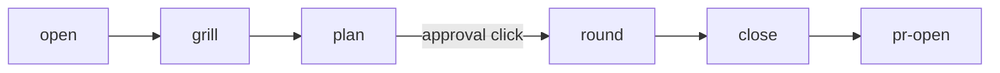

# Mustard

[Português](README.md) · **English**

> AI-assisted software development *harness* — enforces a disciplined, auditable, context-frugal pipeline on top of Claude Code.

**Mustard** wraps Claude Code and turns "ask the AI for a feature" into a **spec-driven pipeline** (Spec-Driven Development / SDD): named phases, blocking gates, and an auditable event trail. Discipline does not depend on the model's goodwill — the **machine enforces it** through hooks and gates.

The project's thesis is **minimum AI, maximum determinism**: everything statistics, graphs, or rules can solve lives in a Rust core; AI shows up only for orchestration and reasoning, never inside the engine.

---

## Installation

Single prerequisite on every OS: **[Claude Code](https://docs.claude.com/claude-code)** installed and logged in (`claude --version` answers). You do **not** need Rust, Node, or any development tooling — the installers ship everything pre-compiled.

### Step 1 — your OS installer

On Windows and macOS, download **one** file from the [**Releases**](https://github.com/rubensrpj/mustard/releases) page (*Assets* section); on **Linux**, a single terminal line does it. Each installer carries the full CLI (`mustard`, `mustard-rt`, `scan`, `rtk`):

| OS | What to download | What to do |
|---|---|---|
| 🪟 **Windows** 10/11 | `Mustard_<version>_x64-setup.exe` | Double-click. On the SmartScreen warning (the installer is unsigned): **"More info" → "Run anyway"**. When done, **open a new terminal** — PATH only applies to terminals opened after the install. |
| 🍎 **macOS** 11+ (Intel + Apple Silicon) | `Mustard-<version>-universal.pkg` | The package is unsigned: **right-click → Open** (Gatekeeper). Follow the wizard, then open a new terminal. |
| 🐧 **Linux** (Ubuntu 22.04+) | none — install in one line:<br>`curl -fsSL https://github.com/rubensrpj/mustard/releases/latest/download/install.sh \| sh` | The script downloads the `.deb` from the latest Release and hands it to `apt` (which resolves the dependencies). Manual route, for whoever wants to check the `sha256` first: download `mustard_<version>_amd64.deb` + `install.sh` into the same folder and run `chmod +x install.sh && ./install.sh` — Release assets arrive **without** the executable bit, and without the `chmod` the shell answers `Permission denied`. |

Verify in a fresh terminal:

```bash
mustard --version
mustard-rt --version
```

The complete walkthrough for each OS (including common issues and uninstall) ships as release *Assets*: `TUTORIAL-WINDOWS.md`, `TUTORIAL-MACOS.md`, `TUTORIAL-LINUX.md`.

### Step 2 — the Claude Code plugin

The harness (the `/mustard:*` commands, hooks, gates and agents) is distributed as a **Claude Code plugin**:

```
/plugin marketplace add rubensrpj/mustard
/plugin install mustard@mustard-local
```

Restart (or reload) Claude Code so the hooks kick in. `add` registers the Mustard repository as a marketplace (it is the one carrying `.claude-plugin/marketplace.json`); the `@mustard-local` in `install` is the **marketplace name**, not a path. `add` also accepts the path of a local clone of this repository — the root containing `.claude-plugin/marketplace.json` — and the repository's full URL (`https://github.com/rubensrpj/mustard.git`), which is the form to use when the `owner/repo` shorthand cannot clone.

> **Automatic binaries:** the plugin ships no binaries in git. On the **first session**, the bootstrap (`mustard-boot`) downloads the `mustard-bins-<version>-<os>` package from the Release assets matching the plugin's version and installs it inside the plugin — silent and fail-open (no network → the session continues normally and it retries next time). If you also ran Step 1, the CLI is on your PATH anyway; both paths coexist.

### Step 3 — prepare a project

At the **root of your project's git repository** (`init` refuses subfolders of a repo — in a monorepo, everything lives at the root):

```bash
cd /path/to/your/project
mustard init
```

This creates `mustard.json`, local settings, the session map and wave/review agents, then builds the project map. Open Claude Code inside the project and describe the work. The native commands provide the next step; the hooks record and guard the flow. Personal rules, models and effort are preserved when updating.

### For developers of this repository

```powershell
# Builds the three binaries in release in a single call (`cargo build --release --locked`),
# copies them to ~/.cargo/bin, and runs `mustard init` on the target:
.\install.ps1                  # target = current directory (with prompt)
.\install.ps1 -Target ..\app   # another project (no prompt)
```

---

## The flow



Every command names the next step. `open` starts the spec; `grill` surveys open points; `plan` checks the plan for user approval. `round` dispatches waves in separate copies, integrates the deliveries, formats the round's files, commits and releases dependent tasks, without building or running proofs. `close` runs the build, the configured lint, the general suite and the criteria proofs on integrated code, reusing only current validation. A final reviewer uses wave summaries to guide code/diff verification, including a single-wave spec. Failures open traceable repairs. `pr-open` opens the pull request; merge requires a user request.

The plugin provides the `/mustard:*` commands:

| Command | Role |
|---|---|
| `/mustard:continue` | Picks the spec back up where it stopped. It is the reserve button: resuming already happens at the start of a session. |
| `/mustard:pr` | Opens the pull request or merges one, only when asked. |
| `/mustard:mods` | Overview, spec, items, one task, usage and settings, read from the local binary without a model turn. Requires Mods support (CLI 2.1.287+). |
| `/mustard:pages` | Explicit `project`, `spec [name]` or `report <file.md>` publication using the native Cloudflare Pages adapter, with the token in `publication.apiToken` of `mustard.json`. Unconfigured projects keep local files; no model turn. |
| `/mustard:upsert` | Installs or updates Mustard in the project and diagnoses the installation. To turn Mustard off in a project, set `"enabled": false` in `mustard.json`. |

---

## Help

Each command says what it does, the options it takes and what it answers:

```bash
mustard-rt run --help            # the list of commands
mustard-rt run <command> --help  # one command, with its options
```

What Mustard does on its own — the installation, the `mustard.json` configuration, the rules and skills it generates, the points where it asks Jev, publishing and code search — is in [docs/mustard-por-dentro.md](docs/mustard-por-dentro.md) (Portuguese). The installation tutorials for each system are in `packaging/installer/TUTORIAL-{WINDOWS,MACOS,LINUX}.md` and in each release's *Assets*.

---

*Distributed under the MIT license.*
