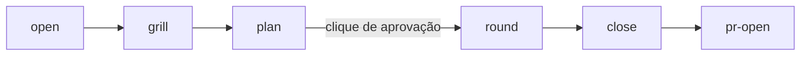

# Mustard

**Português** · [English](README.en.md)

> *Harness* de desenvolvimento de software assistido por IA — impõe um pipeline disciplinado, auditável e econômico em contexto sobre o Claude Code.

O **Mustard** envolve o Claude Code e transforma "peça uma feature para a IA" em um **pipeline orientado a especificação** (Spec-Driven Development / SDD): fases nomeadas, portões bloqueantes e um rastro de eventos auditável. A disciplina não depende da boa vontade do modelo — a **máquina a impõe** via *hooks* e *gates*.

A tese do projeto é **mínimo de IA, máximo de determinismo**: tudo que pode ser resolvido por estatística, grafo ou regra fica num núcleo em Rust; a IA aparece só na orquestração e no raciocínio, nunca embutida no motor.

---

## Instalação

Pré-requisito único em todos os ambientes: **[Claude Code](https://docs.claude.com/claude-code)** instalado e logado (`claude --version` responde). Você **não** precisa de Rust, Node ou qualquer ferramenta de desenvolvimento — os instaladores trazem tudo pré-compilado.

### Passo 1 — instalador do seu sistema

No Windows e no macOS, baixe **um** arquivo na página de [**Releases**](https://github.com/rubensrpj/mustard/releases) (seção *Assets*); no **Linux**, uma linha de terminal resolve. Cada instalador traz o CLI completo (`mustard`, `mustard-rt`, `scan`, `rtk`):

| Sistema | O que baixar | O que fazer |
|---|---|---|
| 🪟 **Windows** 10/11 | `Mustard_<versão>_x64-setup.exe` | Duplo-clique. No aviso do SmartScreen (o instalador não é assinado): **"Mais informações" → "Executar assim mesmo"**. Ao final, **abra um terminal novo** — o PATH só vale em terminais abertos depois da instalação. |
| 🍎 **macOS** 11+ (Intel + Apple Silicon) | `Mustard-<versão>-universal.pkg` | O pacote não é assinado: **botão direito → Abrir** (Gatekeeper). Siga o assistente e abra um terminal novo. |
| 🐧 **Linux** (Ubuntu 22.04+) | nenhum — instale numa linha:<br>`curl -fsSL https://github.com/rubensrpj/mustard/releases/latest/download/install.sh \| sh` | O script baixa o `.deb` do último Release e chama o `apt` (que resolve as dependências). Rota manual, para quem quer conferir o `sha256` antes: baixe `mustard_<versão>_amd64.deb` + `install.sh` na mesma pasta e rode `chmod +x install.sh && ./install.sh` — os assets do Release chegam **sem** a permissão de execução, e sem o `chmod` o shell responde `Permission denied`. |

Verifique num terminal novo:

```bash
mustard --version
mustard-rt --version
```

O passo a passo completo de cada sistema (incluindo problemas comuns e desinstalação) está nos *Assets* de cada release: `TUTORIAL-WINDOWS.md`, `TUTORIAL-MACOS.md`, `TUTORIAL-LINUX.md`.

### Passo 2 — plugin no Claude Code

O harness (comandos `/mustard:*`, hooks, gates e agentes) é distribuído como **plugin do Claude Code**:

```
/plugin marketplace add rubensrpj/mustard
/plugin install mustard@mustard-local
```

Reinicie (ou recarregue) o Claude Code para os hooks entrarem. O `add` registra o repositório do Mustard como *marketplace* (é ele que traz o `.claude-plugin/marketplace.json`); o `@mustard-local` no `install` é o **nome do marketplace**, não um caminho. O `add` também aceita o caminho de um clone local deste repositório — a raiz que contém `.claude-plugin/marketplace.json` — e a URL completa do repositório (`https://github.com/rubensrpj/mustard.git`), que é a forma a usar quando o atalho `owner/repo` não consegue clonar.

> **Binários automáticos:** o plugin não carrega binários no git. Na **primeira sessão**, o bootstrap (`mustard-boot`) baixa o pacote `mustard-bins-<versão>-<sistema>` dos *Assets* do Release correspondente à versão do plugin e o instala dentro do próprio plugin — silencioso e à prova de falha (sem rede, a sessão segue normal e ele tenta de novo na próxima). Quem instalou pelo Passo 1 já tem o CLI no PATH de qualquer forma; os dois caminhos convivem.

### Passo 3 — preparar um projeto

Na **raiz do repositório git** do seu projeto (o `init` recusa subpastas de um repo — num monorepo, tudo vive na raiz):

```bash
cd /caminho/do/seu/projeto
mustard init
```

Isso cria `mustard.json`, configurações locais, mapa de início da sessão e agentes de onda/revisão, e monta o mapa do projeto. Abra o Claude Code no projeto e descreva o trabalho. Os comandos nativos indicam o próximo passo; os ganchos registram e protegem o fluxo. A atualização preserva regras, modelos e esforço pessoais.

### Para desenvolvedores deste repositório

```powershell
# Compila os três binários em release numa chamada só (`cargo build --release --locked`),
# copia para ~/.cargo/bin e roda `mustard init` no alvo:
.\install.ps1                  # alvo = diretório atual (com prompt)
.\install.ps1 -Target ..\app   # outro projeto (sem prompt)
```

---

## O fluxo



Cada comando indica o próximo passo. `open` abre a spec; `grill` levanta pontos abertos; `plan` confere o plano para aprovação do usuário. `round` despacha ondas em cópias separadas, integra entregas autorizadas, executa build e provas pertinentes, comita e libera dependentes. `close` executa lint, suíte geral e critérios sobre o código integrado, reaproveitando apenas validação vigente. Um revisor final usa resumos para orientar a conferência no código/diff, inclusive com uma única onda. Falhas abrem consertos rastreáveis. `pr-open` abre o pull request; merge exige pedido do usuário.

O plugin traz os comandos `/mustard:*`:

| Comando | Papel |
|---|---|
| `/mustard:continue` | Retoma a spec de onde parou. É o botão de reserva: a retomada já acontece no início da sessão. |
| `/mustard:pr` | Abre o pull request ou faz o merge, só a pedido. |
| `/mustard:mods [spec]` | Visão geral, spec, tarefas e demais itens, uma tarefa, consumo e configurações, lidos do binário local. Requer suporte a Mods (CLI 2.1.287+; Code do Desktop 2.1.286+). |
| `/mustard:mods --diagnose` | Mostra versão do host, plugin carregado, interfaces reconhecidas e registro do painel, sem ler conversas ou chamar IA. |
| `/mustard:pages` | Publicação explícita de `project`, `spec [nome]` ou `report <arquivo.md>` pelo adaptador nativo Cloudflare Pages, com o token em `publication.apiToken` do `mustard.json`. Sem configuração, entrega arquivos locais; sem turno do modelo. |
| `/mustard:upsert` | Instala ou atualiza arquivos, índice e ferramentas do projeto. `installation.complete` só é verdadeiro quando a conferência da versão termina sem componentes pendentes; o Mods mostra esse resultado. Para desligar, use `"enabled": false` no `mustard.json`. |

---

## Ajuda

Cada comando diz o que faz, as opções que aceita e o que responde:

```bash
mustard-rt run --help            # a lista dos comandos
mustard-rt run <comando> --help  # um comando, com as opções
```

O que o Mustard faz sozinho — a instalação, a configuração do `mustard.json`, as regras e as skills que ele gera, os pontos em que consulta o Jev, a publicação e a busca de código — está em [docs/mustard-por-dentro.md](docs/mustard-por-dentro.md). Os tutoriais de instalação de cada sistema estão em `packaging/installer/TUTORIAL-{WINDOWS,MACOS,LINUX}.md` e nos *Assets* de cada release.

---

*Distribuído sob a licença MIT.*
